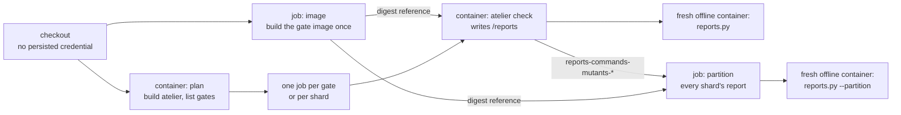

# Contained CI gates

`gates.yml` runs atelier's planner and every gate inside a fresh Linux
container on a GitHub-hosted runner, and no developer runs a gate on their
machine. The installed daemon runs no gate on the Mac; by the owner's proof
contract of 2026-11-17 it observes these contained runs through
`forge.checks` (see
[the audit](../../docs/audits/atelier.md#host-mutation-signal-incident)).
The packaging and docs workflows build on the runner itself; they run no
test, Kani proof or mutant.



| File              | Holds                                                                                |
| ----------------- | ------------------------------------------------------------------------------------ |
| `run.sh`          | The runner-side launcher; refuses to run outside GitHub-hosted Linux                 |
| `floor.sh`        | Whether atelier's own floor applies: the workflow runs from the checked repository   |
| `contained.jq`    | The exact container settings `run.sh` requires of every `docker inspect`             |
| `inspection.json` | A real inspection of the validator, which the self-test varies one setting at a time |
| `Dockerfile`      | Tooling only: Rust, Node, Go, Python, jq, pipx and ruff, with user 10001             |
| `entrypoint.sh`   | Copies the read-only checkout into the container, then plans, checks or validates    |
| `cargo.py`        | A `cargo` front that writes Kani's and cargo-mutants' reports to `/reports`          |
| `shards.py`       | Splits every mutants gate into one job per shard, by cargo-mutants' slicing rule     |
| `reports.py`      | Fail-closed validation of fresh Kani and cargo-mutants reports                       |
| `test_reports.py` | Tests of the validator, `cargo.py`, `contained.jq`, `floor.sh` and the gate config   |
| `gate-image.yml`  | The daily pruner of the gate image's `run-*` versions                                |

## The container

```sh
bash "$CI_SUPPORT/run.sh" gate commands/mutants . "$BASE"
```

Each container runs as user `10001` with its own PID namespace, all
capabilities dropped and `no-new-privileges`. These are bounded: memory (the
runner's less 2 GiB, no swap beyond it), processes and threads (4,096), CPUs
(the runner's less one) and time (10 minutes for the self-test, 60 for the
plan, 75 for a gate, 10 for validation, 10 for a partition, inside each
job's 90). Disk is not bounded beyond the runner's own, and the gate
container's network is Docker's bridge, never the host's, so setup commands
can install pinned tools; the ruff gate's `pipx run` still fetches ruff from
PyPI there.

`run.sh` inspects every container before starting it and refuses one that
fails any check in `contained.jq`. It compares these exactly: user
`10001:10001`, `CapDrop` exactly `ALL`, `SecurityOpt` exactly
`no-new-privileges`, `Privileged` false, `PidMode` empty or `private`,
`IpcMode` `private`, empty `UsernsMode` and `UTSMode`, the intended network
(`bridge` for a gate, `none` for validation), `PidsLimit` 4096, `MemorySwap`
equal to `Memory`, and the mounts' `TYPE:SOURCE:TARGET`, sorted, exactly the
intended set, with every mount read-only and no anonymous mount beside them.
`CapAdd`, `Devices`, `VolumesFrom`, `GroupAdd`, `Tmpfs` and `Binds` need
only be empty, and `Memory` and `NanoCpus` need only be above zero, so their
values are not compared. The self-test runs the filter against
`inspection.json` with one setting changed at a time. This guards against
regressions and daemon defaults, not against an edit to `run.sh` itself.

No container has a Docker socket, runner home, runner command files or token:
the checkout is mounted read-only after `actions/checkout` drops its
credential, and the release download that needs `GH_TOKEN` runs before,
without project code. A private repository's `origin` fetch therefore needs a
public clone or a future read-only mirror; atelier itself is public.

Only plain files and folders cross back to the runner, into
`atelier-reports/container/`, apart from the runner's own inspections: links
that `docker cp` would keep are deleted, and the planner binary must be a
plain file. The job summary takes only known, bounded lines from container
output (`**commands/<gate>:** …`, `**partition:** …` and the
unavailable-base note, 500 bytes each). Each job uploads its folder as
`reports-plan` (without the planner, which is its own artifact) or
`reports-<gate>-<root>-<index>`, and the partition job downloads every
`reports-commands-mutants-*` artifact to judge the shards together.

The gate definitions still come from `origin`'s default branch, as
[slice 2](../../docs/plans/slices/slice-2.md) describes. For another project,
the CI support files come from the reusable workflow's pinned commit
(`job.workflow_sha`). Atelier's own CI calls `./.github/workflows/gates.yml`,
so on its pull requests the workflow, `.github/ci` and the planner come from
the pull request itself: review, not this workflow, keeps a pull request from
loosening its own containment. The judged code can also write its own
`/reports` files, including `base.txt`; the fresh validator checks their
consistency, not their provenance.

## The gate image

Each run builds the gate image once, in the `image` job, tags it
`run-<id>-<attempt>` and pushes it to this repository's `<repository>-gates`
package on ghcr.io; the gate and partition jobs pull it by digest. The tag is
per run because a pull request can push anything under any tag, so a shared
or content-hash tag could poison another run's gate. A gate consumes only the
digest this run published.

The image installs the gates' pinned tools with the same `cargo install`
commands the gate config uses (cargo-deny 0.20.2, cargo-shear 1.14.0,
cargo-mutants 27.1.0 and kani-verifier 0.68.0), so cargo finds each package
already installed and each gate's `cargo install` line changes nothing. Every
install is asserted at build time, so a broken tool layer fails the image,
not a gate. The nextest tarball that nextest and mutants fetch is cheap and
stays out of the image.

The gate and partition jobs pull the published digest only and refuse an
image whose `RepoDigests` does not equal it. When there is no digest, or this
runner cannot pull exactly it, the job builds the image without the tools (a
plain `docker build --build-arg TOOLS=0`), so no gate depends on the registry
being reachable. The job summary says which path ran:
`image pulled: <digest>`, or
`image not shared: <reason>; this job builds it without the pinned tools`.

For kani, only its `cargo install` is saved: `cargo kani setup` always
re-downloads, because its proxy treats an explicit setup as an explicit
setup, so the kani gate still pays that download.

The image job's build runs on the runner, outside a container, under a
30-minute limit inside its 90-minute job; its token reaches only the registry
login. The pulled image is the container's image, not a mount: the gate
container's mounts, network and `contained.jq` contract are exactly the ones
described above.

`.github/workflows/gate-image.yml` prunes the package daily. It deletes the
versions older than seven days whose every tag matches `run-*`, never one
carrying any other tag, keeps an untagged version, logs one line per version
and one per deletion, and fails the job when it cannot list them.

## Sharding the mutants gate

The plan splits each mutants gate into shards, so the gate runs as four
jobs instead of one. `gates.yml` sets `ATELIER_MUTANTS_SHARDS` to 4, and
the plan container pipes the planner's matrix through `shards.py expand`:
each mutants gate becomes one entry per shard, each carrying its own
`"shard": "k/4"`. Every entry is a matrix job of its own, named
`commands/mutants (.) [1/4]`; the gates that do not shard stay as they are.

`run.sh` passes the shard to the gate container as `ATELIER_SHARD`, and
`cargo.py` adds `--shard k/4` to every cargo-mutants run it starts, whether
it tests the diff, the canary or the configured set. All four shards
therefore measure the same selection with the same denominator, as
cargo-mutants' sharding requires.

Each shard writes `/reports/mutants-selection.json` with its gate, root
and shard, the whole gate's mutant total and the names of its own slice,
beside the mode, diff and canary fields. A fresh offline container still
judges each shard's report on its own: cargo-mutants 27.1, a successful
baseline, exactly the mutants its selection names, no missed mutant and no
timeout. A shard whose slice of the selection is empty may test no mutant,
and only then, because the partition check proves the slice really is
empty: cargo-mutants slices as `chunk = ceil(total / n)`, shard `k` taking
chunk `k`, so the size of every slice follows from the whole total. A run
that is not sharded still fails on zero mutants. A sharded summary line
opens with `shard k/n of T mutants: ` and counts only that shard's slice.

The `partition` job closes the run. It needs every gate job and runs even
when one failed, and it downloads every `reports-commands-mutants-*`
artifact. In a fresh offline container, with only that directory mounted
read-only, `reports.py --partition 4` proves that every shard's report is
there, that the shard indexes are exactly 0 to 3 once each, that all shards
agree on the whole total, that no mutant is tested twice, and that the
tested mutants add up to it. When any shard wrote a safeguard selection,
the validator also proves that every shard wrote one, with the same
indexes as the main selections, one whole total, no mutant tested twice,
and the tested mutants equal to it. A directory that carries a safeguard
selection but no main selection fails. A canary run must still catch one
mutant across the shards and mutate only the canary. A missing shard
report fails the gate here. The summary says `**partition:** 4 shards, 107
mutants, 0 missed, 0 timeouts`, then `; safeguard 4 shards, N mutants`
when a safeguard ran.

Sharding weakens no gate. No gate moved off a pull request, no run adds
`--baseline=skip` or an exclusion, and no container gained a mount:
`contained.jq` keeps its exact contract, and the partition container has
the same single read-only mount as the validator, with no network. The
shard count is a workflow environment value, not a gate setting, so a gate
container that is given no shard tests the whole selection in one run.

## Reports

A gate passes only when `atelier check` exits 0 and a fresh container,
offline and with the reports mounted read-only, finds them valid. The gate
cannot change the validator or the interpreter that runs it.

- **Kani:** `/reports/kani.json` from Kani 0.68.0: every harness completed
  and successful, with matching property counts. When the workflow runs from
  the repository it checks (`job.workflow_repository` equals
  `github.repository`: atelier's own CI), both core proofs in
  `machine::proofs` are also required. The summary names the harness count
  and whether that floor applied. A project that copies `gates.yml` into its
  own repository and calls it locally also matches, and would need atelier's
  proofs and canary; projects call atelier's pinned workflow instead.
- **Mutants:** `/reports/mutants.out/outcomes.json` from cargo-mutants 27.1.0
  has a finished run, a successful baseline, at least one mutant, and no
  missed, timed-out or failed mutant. Unviable mutants keep their existing
  meaning. The tested mutants must be exactly those
  `/reports/mutants-selection.json` recorded, which holds the gate, root
  and whole-gate total, the shard when the run is sharded, and the names
  it selects. Only a shard whose slice of that total is empty, as
  the partition check proves, may test no mutant; a run that is not
  sharded still fails on zero. A diff that deletes tests also writes
  `/reports/mutants-safeguard/mutants.out/outcomes.json` and
  `/reports/mutants-safeguard.json`, judged by the same report checks as
  the main report, and a sharded gate's summary also says `; safeguard 4
  shards, N mutants`.

Before an empty selection counts, `cargo.py` proves the diff can be made:
`git diff --name-only "$ATELIER_BASE" --` must succeed, and the repository
files it changes are recorded (the mutants diff itself covers only `crates`
and `plugins`). A refusal from `cargo.py` is one `atelier CI:` line, with the
tool's last stderr line when a tool failed or timed out, and one line when
cargo itself runs past the hour.

The canary runs only when the plan includes `commands/mutants` and its diff
selects nothing: a change the root `.` holds (such as the root `README.md`
or `Cargo.toml`) but no mutable line in `crates` or `plugins`. A change
only under `docs/`, `scripts/` or `.github/` plans no mutants gate at all.
Then `cargo.py` mutates the canary
`crates/cli/src/command_step/run.rs`, the background step runner whose
cleanup reached the host incident's broadcast kill, so the gate's evidence
is never empty and the run stays within the gate's hour. The job summary
says `diff changed K repository files, selected N mutants; canary 0
mutants (not run)` or `diff changed K repository files, selected 0
mutants; canary M mutants` with the reason; a canary run never reads as
diff coverage. Both keep the floor of 0 missed and 0 timeouts; a canary
must also have at least one caught mutant and mutate only its own file. A
missing canary, or one that yields no mutant, fails the gate.

The canary is atelier's own, under the same rule as the Kani floor, which
`floor.sh` decides. In another project, a diff that selects no mutant fails
the mutants gate with that reason.

A push to `main` diffs against the push's `before` commit. When that is all
zeros or unreachable (a first or forced push), every gate runs, mutants use
the canary, the selection records the diff as not evaluated, and the summary
says `diff not evaluated`.

Every report is uploaded as an artifact, also when the gate fails. The upload
step runs when the job is not cancelled and the step its condition names has
not skipped: `selftest` in the plan job, `gate` in a gate job. A cancelled
run, or a job stopped by its job-level 90-minute timeout, uploads no report.

Linux containers do not prove Darwin's process-group signalling. That needs a
separately approved disposable macOS environment.

## Production files of deleted tests

A deleted test cannot fail, so when a diff removes a `#[test]` or a
`#[kani::proof]`, the gate also mutates the production files those tests
covered: the diff's own selection no longer proves that code. `cargo.py`
reads each changed `.rs` file under `crates/` or `plugins/` at the base
and now, and treats each test name the base held and the tree does not as
deleted.

A deleted test in a crate's `src/` file covers that file, or its `.rs`
siblings when the file itself is gone. A deleted test in
`crates/<crate>/tests/` or `plugins/<crate>/tests/` covers every `.rs`
file under that crate's `src/`.

The safeguard is a second cargo-mutants run in the same gate, with one
`--file` per production file and the gate job's shard when it has one,
written to `/reports/mutants-safeguard/mutants.out`. Its own selection,
`/reports/mutants-safeguard.json`, names the deleted tests and the covered
files. A fresh container judges a shard's safeguard report by the same
report checks as its main report.

`cargo.py` refuses the run when the deleted tests cover no production
file, when they cover more than 64 files (split the change), and when the
covered files hold no mutant (restore the tests, or name the equivalents
in `.cargo/mutants.toml` for review). The safeguard only ever adds work,
never removes a check: the diff's own selection is still required and
still judged. A diff whose base is unavailable, so that `base.txt`
records it as not evaluated, writes no safeguard; the canary runs there
instead.
