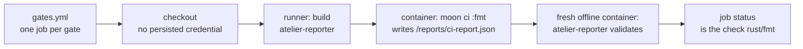

# Contained CI gates

`gates.yml` runs each of atelier's gates as its own matrix job on a
GitHub-hosted runner, with the gate's moon task inside a fresh Linux
container. The job's status is the gate's GitHub check, such as
`rust/fmt`, so no job holds a token that can write, and nothing creates
checks through the API. No developer runs a gate on their machine.



| File              | Holds                                                                                 |
| ----------------- | ------------------------------------------------------------------------------------- |
| `run.sh`          | The runner-side launcher; refuses to run outside GitHub-hosted Linux                  |
| `contained.jq`    | The exact container settings `run.sh` requires of every `docker inspect`              |
| `inspection.json` | A real inspection of the validator, to check `contained.jq` against                   |
| `Dockerfile`      | Gate tooling only: Rust 1.100.0, moon 2.6.5, Kani, Miri and pinned cargo tools         |
| `entrypoint.sh`   | Copies the read-only checkout into the container, then runs moon ci or validates      |

The gates are the tasks in `.moon/tasks/rust.yml`: `rust/fmt`,
`rust/clippy`, `rust/test`, `rust/kani`, `rust/miri`, `rust/mutants` and
`rust/msrv`. The report checks that `reports.py` and `test_reports.py` did at
f687307 are ported into the Rust reporter, `atelier-reporter`.

The runner builds the reporter as a static musl binary for the container,
but Kani, Miri, the tests and the mutants execute only inside the gate
container, never on the runner or a developer machine.

`metrics.yml` runs `metrics/complexity` through
`run.sh metrics`. The same bounded container checks out the base commit as a
worktree and runs the pinned `rust-code-analysis-cli` on both trees, writing
`base/` and `head/` json reports, and fails if either holds no json. The
runner builds `atelier-metrics` as a static musl binary, mounted read-only at
`/binary` like the reporter, and `atelier-metrics complexity` compares the two
inside the same container; its exit status is the container's, and so the
check. Its table goes to `summary.txt`, which the runner only shows in the job
summary. `run.sh` also fails if either report folder comes back empty. There
is no moon report, so no reporter or offline validation.

`metrics/performance` runs the same Gungraun benchmark harness on both trees
in the bounded container, each with `cargo bench --locked`. The base's
`reporter/benches/library_benchmark.rs`, `reporter/Cargo.toml`, the
workspace `Cargo.toml` and `.cargo/` replace head's, so a pull request cannot
weaken the benchmark, redirect its `[lib]` or `[[bench]]` targets, or change
the profile or rustflags it is measured with. A benchmark that only head has
is measured with head's own manifest before the base's files replace it. Each
tree keeps its own `Cargo.lock`. The base harness is required: a base without it is a named
failure, and the harness is never copied from head. The harness has no
slowdown switch in its environment.

Head is measured first, in its own contained job with no access to the trusted
reports. Its Callgrind `Ir` count is copied out and mounted read-only into a
second contained job, which measures base, applies the limit and writes the
summary. A pull request cannot rewrite the base measurement or the limit,
because it cannot write that evidence at all. `atelier-metrics budget`
compares the two `Ir` counts directly. At any non-negative limit, an
unchanged or smaller count always passes; only an increase is compared,
strictly, against the limit, and the check fails when it is at or past it:
with the 5% limit, +4% passes and +5% and +6% fail. The limit is
`instruction_limit_percent` in `.moon/config/metrics.toml`, read from both
trees, and the stricter applies: a head may tighten its budget, but not loosen
it. The job summary shows the limit that applied and the comparison; a missing
or empty summary fails the check. A benchmark that head has and base lacks is
judged against `new_bench_instruction_ir`, its absolute budget, and fails
closed when that budget is absent.

`metrics/budget-proof` proves the verdict in CI. Its slowdown run patches
`results()` in head's working tree with a real loop, a genuine regression in
the measured function, and the gate fails; the unpatched code passes.

The gate catches regressions in honest code. It does not defend against a
pull request that games its own measurement, any more than the test gate
defends against one that rewrites its tests; that gaming is the review bot's
gaming digest and the owner's concern (supervisor, 2026-11-26).

`metrics/spread` runs the benchmark ten times, with ASLR on, in the same
contained runner and writes the ten Callgrind `Ir` values; the CI job requires
their spread to stay under 0.5%. This is why the performance gate sets
`GUNGRAUN_ALLOW_ASLR`: address layout randomisation does not move the count.

## The container

```sh
GATE=rust/fmt GATES=rust/fmt BASE="$BASE" bash "$CI_SUPPORT/run.sh" gate
```

Each container runs as user `10001` with its own PID namespace, all
capabilities dropped and `no-new-privileges`. It is bounded in memory (the
runner's less 2 GiB, no swap beyond it), processes and threads (4,096), CPUs
(the runner's less one) and time (10 minutes for the self-test and
validation, 75 for the gate, inside the job's 90). The gate container's
network is Docker's bridge, never the host's, so cargo can fetch crates; the
self-test and validation containers have no network.

`run.sh` inspects every container before starting it and refuses one that
fails any check in `contained.jq`: user `10001:10001`, `CapDrop` exactly
`ALL`, `SecurityOpt` exactly `no-new-privileges`, not privileged, a private
PID and IPC namespace, the intended network, `PidsLimit` 4096, `MemorySwap`
equal to `Memory`, and exactly the intended mounts, every one read-only. This
guards against regressions and daemon defaults, not against an edit to
`run.sh` itself.

No job has a token beyond read access to the repository, and no container
has a Docker socket, runner home, runner command files or token.
The checkout is mounted read-only at `/source` after `actions/checkout`
drops its credential, and the reporter, a plain file, at `/binary`. Only
plain files and folders cross back to the runner, into
`atelier-reports/container/`; links `docker cp` would keep are deleted.

## Reports

The gate container runs `moon ci` for its one task. A gate container that
exits non-zero, or writes no non-empty `ci-report.json`, fails. A fresh
container, offline, with the report and the reporter mounted read-only, then
validates the report inside the same job; the gate cannot change either. A
last step runs the reporter on the runner, after a failed gate too, to write
the gate's line to the job summary; the offline container stays the
validator of record. The rule is fail-closed: a missing or invalid report
fails the job, and so the check.

## Self-test

```sh
bash "$CI_SUPPORT/run.sh" selftest
```

It needs `SOURCE` and a built
`target/x86_64-unknown-linux-musl/release/atelier-reporter`, and checks
that the reporter is executable and that moon and jq run, with no network.

Atelier's own pull requests run the workflow and `.github/ci` they contain,
so review, not this workflow, keeps a pull request from loosening its own
containment.
