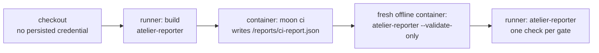

# Contained CI gates

`gates.yml` runs atelier's gates as moon tasks inside a fresh Linux container
on a GitHub-hosted runner, then publishes one GitHub check per gate. No
developer runs a gate on their machine.



| File              | Holds                                                                                 |
| ----------------- | ------------------------------------------------------------------------------------- |
| `run.sh`          | The runner-side launcher; refuses to run outside GitHub-hosted Linux                  |
| `contained.jq`    | The exact container settings `run.sh` requires of every `docker inspect`              |
| `inspection.json` | A real inspection of the validator, to check `contained.jq` against                   |
| `Dockerfile`      | Gate tooling only: Rust 1.100.0, moon 2.6.5, Kani, Miri and pinned cargo tools         |
| `entrypoint.sh`   | Copies the read-only checkout into the container, then runs moon ci or validates      |

The gates are the tasks in `.moon/tasks/rust.yml`: `rust/fmt`,
`rust/clippy`, `rust/test`, `rust/kani`, `rust/miri`, `rust/mutants` and
`rust/msrv`. The report checks that `reports.py` and `test_reports.py` did at
f687307 are ported into the Rust reporter, `atelier-reporter`.

## The container

```sh
GATES="rust/fmt rust/clippy" BASE="$BASE" bash "$CI_SUPPORT/run.sh" gate
```

Each container runs as user `10001` with its own PID namespace, all
capabilities dropped and `no-new-privileges`. It is bounded in memory (the
runner's less 2 GiB, no swap beyond it), processes and threads (4,096), CPUs
(the runner's less one) and time (10 minutes for the self-test and
validation, 75 for the gate, inside the job's 90). The gate container's
network is Docker's bridge, never the host's, so cargo can fetch crates; the
self-test and validation containers have no network.

`run.sh` inspects every container before starting it and refuses one that
fails any check in `contained.jq`: user `10001:10001`, `CapDrop` exactly
`ALL`, `SecurityOpt` exactly `no-new-privileges`, not privileged, a private
PID and IPC namespace, the intended network, `PidsLimit` 4096, `MemorySwap`
equal to `Memory`, and exactly the intended mounts, every one read-only. This
guards against regressions and daemon defaults, not against an edit to
`run.sh` itself.

No container has a Docker socket, runner home, runner command files or token.
The checkout is mounted read-only at `/source` after `actions/checkout`
drops its credential, and the reporter, a plain file, at `/binary`. Only
plain files and folders cross back to the runner, into
`atelier-reports/container/`; links `docker cp` would keep are deleted. The
job summary takes only lines such as `rust/fmt: passed` or `rust/fmt: failed`
from the validator, 500 bytes each.

## Reports

A gate container that exits non-zero, or writes no non-empty
`ci-report.json`, fails. A fresh container, offline, with the report and
the reporter mounted read-only, then validates the report; the gate cannot
change either. The rule is fail-closed: a missing or invalid report fails
every gate, and the reporter publishes each one as a failed check.

## Self-test

```sh
bash "$CI_SUPPORT/run.sh" selftest
```

It needs `SOURCE` and a built `target/release/atelier-reporter`, and checks
that the reporter is executable and that moon and jq run, with no network.

Atelier's own pull requests run the workflow and `.github/ci` they contain,
so review, not this workflow, keeps a pull request from loosening its own
containment.
