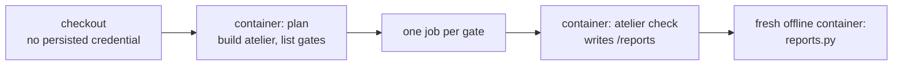

# Contained CI gates

`gates.yml` runs atelier's planner and every gate inside a fresh Linux
container on a GitHub-hosted runner, and no gate runs on a developer machine.
The packaging and docs workflows build on the runner itself; they run no
test, Kani proof or mutant.



| File              | Holds                                                                             |
| ----------------- | --------------------------------------------------------------------------------- |
| `run.sh`          | The runner-side launcher; refuses to run outside GitHub-hosted Linux              |
| `Dockerfile`      | Tooling only: Rust, Node, Go, Python, pipx and ruff, with user 10001              |
| `entrypoint.sh`   | Copies the read-only checkout into the container, then plans, checks or validates |
| `cargo.py`        | A `cargo` front that writes Kani's and cargo-mutants' reports to `/reports`       |
| `reports.py`      | Fail-closed validation of fresh Kani and cargo-mutants reports                    |
| `test_reports.py` | The validator's and `cargo.py`'s own tests, run before every plan                 |

## The container

```sh
bash "$CI_SUPPORT/run.sh" gate commands/mutants . "$BASE"
```

Each container runs as user `10001` with its own PID namespace, all
capabilities dropped and `no-new-privileges`. These are bounded: memory (the
runner's less 2 GiB, no swap beyond it), processes and threads (4,096), CPUs
(the runner's less one) and time (10 minutes for the self-test, 60 for the
plan, 75 for a gate, 10 for validation, inside each job's 90). Disk is not
bounded beyond the runner's own, and the gate container's network is Docker's
bridge, never the host's, so setup commands can install pinned tools; the
ruff gate's `pipx run` still fetches ruff from PyPI there.

`run.sh` inspects every container before starting it and refuses one whose
settings differ from exact values: user, `CapDrop` `ALL` with no `CapAdd`,
`SecurityOpt` exactly `no-new-privileges`, not privileged, private PID and
IPC, no user or UTS namespace mode, the intended network (`bridge` for a gate,
`none` for validation), no devices or `VolumesFrom`, 4,096 processes,
swap equal to memory, a CPU limit, read-only mounts whose type, source and
target are exactly the intended ones. This guards against regressions and daemon defaults, not
against an edit to `run.sh` itself.

No container has a Docker socket, runner home, runner command files or token:
the checkout is mounted read-only after `actions/checkout` drops its
credential, and the release download that needs `GH_TOKEN` runs before,
without project code. A private repository's `origin` fetch therefore needs a
public clone or a future read-only mirror; atelier itself is public.

Only plain files and folders cross back to the runner, into
`atelier-reports/container/`, apart from the runner's own inspections: links
that `docker cp` would keep are deleted, and the planner binary must be a
plain file. The job summary takes only known, bounded lines from container
output (`**commands/<gate>:** …` and the unavailable-base note, 500
bytes each). Each job uploads its folder as `reports-plan` (without the
planner, which is its own artifact) or `reports-<gate>-<root>-<index>`.

The gate definitions still come from `origin`'s default branch, as
[slice 2](../../docs/plans/slices/slice-2.md) describes. For another project,
the CI support files come from the reusable workflow's pinned commit
(`job.workflow_sha`). Atelier's own CI calls `./.github/workflows/gates.yml`,
so on its pull requests the workflow, `.github/ci` and the planner come from
the pull request itself: review, not this workflow, keeps a pull request from
loosening its own containment.

## Reports

A gate passes only when `atelier check` exits 0 and a fresh container,
offline and with the reports mounted read-only, finds them valid. The gate
cannot change the validator or the interpreter that runs it.

- **Kani:** `/reports/kani.json` from Kani 0.68.0: every harness completed
  and successful, with matching property counts. When the workflow runs from
  the repository it checks (`job.workflow_repository` equals
  `github.repository`: atelier's own CI), both core proofs in
  `machine::proofs` are also required. The summary names the harness count
  and whether that floor applied. A project that copies `gates.yml` into its
  own repository and calls it locally also matches, and would need atelier's
  proofs and canary; projects call atelier's pinned workflow instead.
- **Mutants:** `/reports/mutants.out/outcomes.json` from cargo-mutants 27.1.0
  has a finished run, a successful baseline, at least one mutant, and no
  missed, timed-out or failed mutant. Unviable mutants keep their existing
  meaning. The tested mutants must be exactly those
  `/reports/mutants-selection.json` recorded.

Before an empty selection counts, `cargo.py` proves the diff can be made:
`git diff --name-only "$ATELIER_BASE" --` must succeed, and the repository
files it changes are recorded (the mutants diff itself covers only `crates`
and `plugins`). A refusal from `cargo.py` is one `atelier CI:` line, with the
tool's last stderr line when a tool failed or timed out. The canary runs only when the plan includes `commands/mutants` and its diff
selects nothing: a change the root `.` holds (such as the root `README.md` or
`Cargo.toml`) but no mutable line in `crates` or `plugins`. A change only
under `docs/`, `scripts/` or `.github/` plans no mutants gate at all. Then `cargo.py` mutates
the canary `crates/cli/src/command_step/run.rs`, the background step runner
whose cleanup reached the host incident's broadcast kill, so the report is
never empty and the run stays within the gate's hour. The job summary says
`diff changed K repository files, selected N mutants; canary 0 mutants (not
run)` or `diff changed K repository files, selected 0 mutants; canary M
mutants` with the reason; a canary run never reads as diff coverage. Both keep the floor of
0 missed and 0 timeouts; a canary must also have at least one caught mutant
and mutate only its own file. A missing canary, or one that yields no mutant,
fails the gate.

The canary is atelier's own, under the same rule as the Kani floor. In another project, a diff that selects no
mutant fails the mutants gate with that reason.

A push to `main` diffs against the push's `before` commit. When that is all
zeros or unreachable (a first or forced push), every gate runs, mutants use
the canary, the selection records the diff as not evaluated, and the summary
says `diff not evaluated`.

Every report is uploaded as an artifact, also when the gate fails.

Linux containers do not prove Darwin's process-group signalling. That needs a
separately approved disposable macOS environment.
