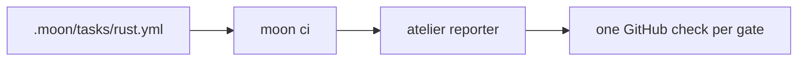

# atelier

A CI engine for monorepos: gate presets on moon, one GitHub check per gate.

## Status

The presets, reporter and wiring are planned, not shipped. This repository
holds the approved design and its slice plans. Install and usage instructions
arrive with the first slice. The CI workflow here builds these docs.

## Design

The approved design has three parts, each a separate slice.

**Presets (planned).** A Rust preset names fmt, clippy, test, Kani, miri,
cargo-mutants and MSRV as moon tasks. Presets stay plain task files, so moving
to another runner later stays cheap.

**Reporter (planned).** The reporter reads moon's results and posts one GitHub
check per gate. A missing or failed result fails its gate. How task names map
to check names is an open question in the approved design.

**Runner (planned).** Project wiring runs `moon ci` and the reporter in CI.
The same command runs locally in a container; no gate runs on the host.

## Roadmap

- [ ] Rust gate presets on moon
      ([#87](https://github.com/wrkhse/atelier/issues/87))
- [ ] Metrics against the previous version
      ([#88](https://github.com/wrkhse/atelier/issues/88))
- [ ] Agent review as a check
      ([#89](https://github.com/wrkhse/atelier/issues/89))
- [ ] Builder plugin on tack, driven by sourcefed events
      ([#85](https://github.com/wrkhse/atelier/issues/85))
- [ ] TypeScript and TLA+ presets — later, no issue yet

## More

- [The approved design](https://github.com/wrkhse/atelier/issues/85) and
  [the plan](https://github.com/wrkhse/atelier/issues/1).
- [Slice plans](docs/plans/README.md).
- [Working on atelier](AGENTS.md).
