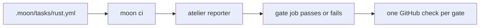

# atelier

A CI engine for monorepos: gate presets on moon, one GitHub check per gate.

## Status

The Rust gate presets and reporter are in the 0.2.0-rc.1 release candidate,
with one GitHub check per gate. Install instructions are in this README and
the release.

## Install

Download and verify the Linux x64 release archive, then extract it:

```sh
gh release download v0.2.0-rc.1 --repo wrkhse/atelier \
  --pattern 'atelier-v0.2.0-rc.1-linux-x64.tar.gz' --pattern SHA256SUMS
sha256sum --check --ignore-missing SHA256SUMS
tar -xzf atelier-v0.2.0-rc.1-linux-x64.tar.gz
export PATH="$PWD/bin:$PATH"
```

The archive also carries the moon task presets.

## Design



The approved design has three parts, built together in slice 1.

**Presets (in progress).** A Rust preset names fmt, clippy, test, Kani, miri,
cargo-mutants and MSRV as moon tasks. Presets stay plain task files, so moving
to another runner later stays cheap.

**Reporter (in progress).** The reporter judges moon's results; each gate's CI
job is the check. A missing or failed result fails its gate. The reporter maps a
result by the moon target's task id.

**Runner (in progress).** Project wiring runs `moon ci` and the reporter in CI.
The same command runs locally in a container; no gate runs on the host.

## Roadmap

- [ ] Rust gate presets on moon
      ([#87](https://github.com/wrkhse/atelier/issues/87))
- [ ] Metrics against the previous version
      ([#88](https://github.com/wrkhse/atelier/issues/88))
- [ ] Agent review as a check
      ([#89](https://github.com/wrkhse/atelier/issues/89))
- [ ] Builder plugin on tack, driven by sourcefed events
      ([#85](https://github.com/wrkhse/atelier/issues/85))
- [ ] TypeScript and TLA+ presets — later, no issue yet

## More

- [The approved design](https://github.com/wrkhse/atelier/issues/85) and
  [the plan](https://github.com/wrkhse/atelier/issues/1).
- [Slice plans](docs/plans/README.md) and
  [Slice 1](docs/plans/slices/slice-1.md).
- [Working on atelier](AGENTS.md).
