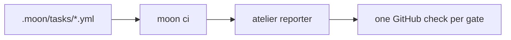

# atelier

A CI engine for monorepos: gate presets on moon, one GitHub check per gate.

atelier ships inheritable gate presets as moon task files. A project inherits
`.moon/tasks/rust.yml`, `typescript.yml` or `tla.yml`; `moon ci` runs their gates,
and atelier's reporter turns each result into one check on the pull request.
Presets stay plain task files, so moving to another runner later stays cheap.
Gates run in CI or a container, never on a developer's machine.

## Design

**Presets.** Each preset names its gates as moon tasks. Rust: fmt, clippy,
test, Kani, miri, cargo-mutants and MSRV. TypeScript: lint, typecheck, test.
TLA+: TLC. A gate is a command a container can run; its result is one check.

**Reporter.** The reporter reads moon's results and posts one GitHub check per
gate. A missing or failed result fails its gate. Presets stay independent of
the reporter, so check names come from the task names.

**Runner.** Project wiring runs `moon ci` and the reporter in CI. The same
command runs locally in a container; no gate runs on the host.

## Status

The presets, reporter and wiring are planned work, not yet shipped. This
repository holds the approved design and its slice plans. Install and usage
instructions arrive with the first slice.

## Roadmap

- [ ] Rust gate presets on moon
      ([#87](https://github.com/wrkhse/atelier/issues/87))
- [ ] Metrics against the previous version
      ([#88](https://github.com/wrkhse/atelier/issues/88))
- [ ] Agent review as a check
      ([#89](https://github.com/wrkhse/atelier/issues/89))
- [ ] Builder plugin on tack, driven by sourcefed events
      ([#85](https://github.com/wrkhse/atelier/issues/85))

## More

- [The approved design](https://github.com/wrkhse/atelier/issues/85) and
  [the plan](https://github.com/wrkhse/atelier/issues/1).
- [Slice plans](docs/plans/README.md).
- [Working on atelier](AGENTS.md).
