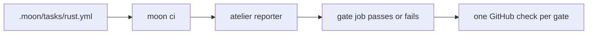

# atelier

A CI engine for monorepos: gate presets on moon, one GitHub check per gate.

## Status

The Rust gate presets and reporter are in v0.2.0-rc.1, with one GitHub
check per gate. Install instructions are in this README and the release.

## Install

Download and verify the Linux x64 release archive, then extract it:

```sh
gh release download v0.2.0-rc.1 --repo wrkhse/atelier \
  --pattern 'atelier-v0.2.0-rc.1-linux-x64.tar.gz' --pattern SHA256SUMS
rg -F "  atelier-v0.2.0-rc.1-linux-x64.tar.gz" SHA256SUMS > archive.sha256
sha256sum --check archive.sha256
tar -xzf atelier-v0.2.0-rc.1-linux-x64.tar.gz
export PATH="$PWD/bin:$PATH"
```

Copy the released `.moon` configuration and `.prototools` into the consumer
repository root:

```sh
cp -R .moon /path/to/consumer/
cp .prototools /path/to/consumer/
```

The consumer defines its project mappings in `.moon/workspace.yml` and wires
the presets into its own CI workflow; each gate then appears as its own
GitHub check. The reporter binary runs from the archive's `bin/` directory.

## Design



The approved design has three parts, built together in slice 1.

**Presets.** A Rust preset names fmt, clippy, test, Kani, miri,
cargo-mutants and MSRV as moon tasks. Presets stay plain task files, so moving
to another runner later stays cheap.

**Reporter.** The reporter judges moon's results; each gate's CI
job is the check. A missing or failed result fails its gate. The reporter maps a
result by the moon target's task id.

**Runner.** Project wiring runs `moon ci` and the reporter in CI.
The same command runs locally in a container; no gate runs on the host.

The instruction budget uses atelier's `atelier-metrics budget` command.
Both trees use the required base harness, with each tree's own manifests,
lockfile and `.cargo` settings. Head-only benchmarks use head's manifest and
run before the harness is replaced. Head writes its own counts in a contained
job; they are mounted read-only into the job that measures base and judges.
Head cannot write the base measurement, saved baseline, applied limits,
summary or trusted verdict. In CI, a slowdown patched into the measured
function fails, and the unpatched code passes. The gate catches regressions
in honest code, not a pull request that games its own measurement (supervisor,
2026-11-26).

## Roadmap

- [x] Rust gate presets on moon
      ([#87](https://github.com/wrkhse/atelier/issues/87),
      [v0.2.0-rc.1](https://github.com/wrkhse/atelier/releases/tag/v0.2.0-rc.1))
- [ ] Metrics against the previous version
      ([#88](https://github.com/wrkhse/atelier/issues/88),
      [Slice 2](docs/plans/slices/slice-2.md))
- [ ] Builder plugin on tack, driven by sourcefed events
      ([#85](https://github.com/wrkhse/atelier/issues/85))
- [ ] TypeScript and TLA+ presets — later, no issue yet

### Separate add-ons (after the core)

- [ ] Agent review as a check
      ([#89](https://github.com/wrkhse/atelier/issues/89))
- [ ] Docs gate ([#98](https://github.com/wrkhse/atelier/issues/98))

## More

- [The approved design](https://github.com/wrkhse/atelier/issues/85) and
  [the plan](https://github.com/wrkhse/atelier/issues/1).
- [Slice plans](docs/plans/README.md) and
  [Slice 1](docs/plans/slices/slice-1.md).
- [Working on atelier](AGENTS.md).
