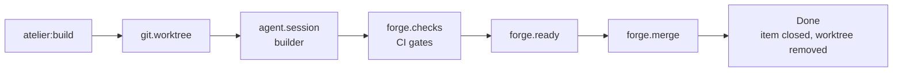
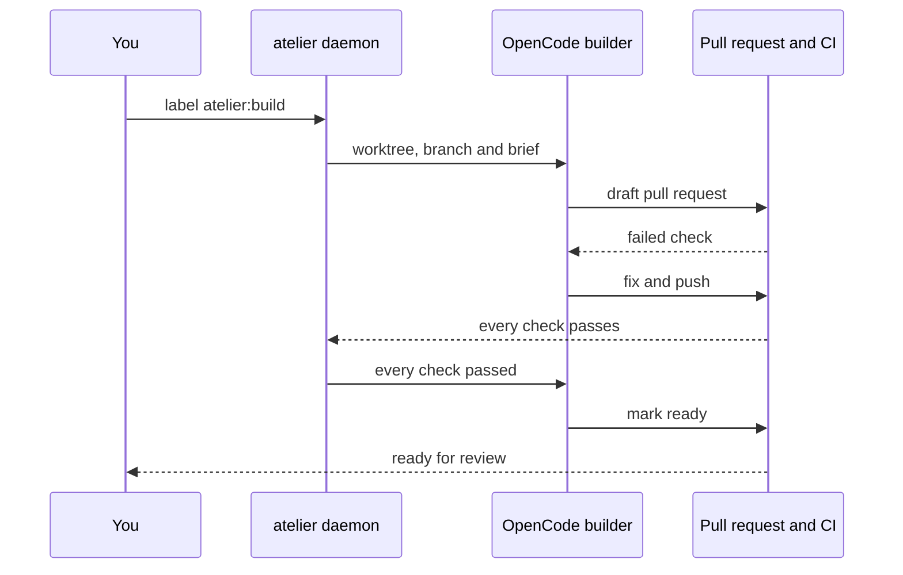

# atelier

atelier is a CI engine that gives monorepos easy access to best-practice CI. It
is a tack plugin; a builder agent and issue detection through sourcefed are
extensions.

With the builder, atelier turns a labelled GitHub issue into a pull request
ready for your review.
You add `atelier:build` to an issue; atelier starts an OpenCode builder on its
own branch and worktree, the builder opens a draft pull request and pushes fixes
until every check passes, then marks it ready.

Your project's gates run in GitHub's CI, one check each, and their fixes, such
as a formatter, run on every commit a builder makes. Labels on the issue
show where its work is, and the daemon saves each step before taking it, so it
can stop at any moment and carry on where it was.

## Design

atelier is a step machine. A mark on an item starts a run of one of the
project's pipelines; each step settles with an outcome, and steps whose needs
hold start together. The label-to-pull-request loop is the built-in `build`
pipeline:



**Pipelines.** A project defines any number of pipelines, each a set of steps
in its config. A step's `uses` names a kind by role or plugin; `after` and
`after_any` name the outcomes it waits for, and `outcomes`, `rounds` and
`restart` bound how it settles. Steps that become ready together start
together, a failed step starts again under its `rounds` limit, and a final
failure with no step to receive it blocks the run.

**Runs.** A run is one pass of a pipeline for one item, such as
`build github#12`, and an item has at most one working run. When no step runs
and none can start, the run is Done and closes the item with a comment listing
every step's outcome. Every way out removes the working mark, interrupts
resident agent sessions, cancels background commands and removes the worktree.

**The machine.** Core lowers each pipeline to a plan on
[rungs](https://github.com/StevenJPx2/rungs/issues/1), a `no_std` step machine
with no dependencies and no I/O, proven with Kani for starts, skips, bounded
attempts, restarts and completion. Each run's progress is saved before an
action, so a stop at any point resumes from the last saved step.

**Roles.** Plugins fill roles that core knows by contract, not by name:

| Role    | Does                                       | Plugin here                |
| ------- | ------------------------------------------ | -------------------------- |
| Trigger | Says when a run starts or stops            | sourcefed                  |
| Tracker | Reads, marks, comments on and closes items | github, local              |
| Forge   | Finds the pull request and its checks      | github                     |
| Agent   | Starts a resident session with the brief   | opencode                   |
| Checks  | Names each root's gates and fixes          | commands, language plugins |

**The brief.** Core assembles the builder's brief from its contract, the item,
the pull request, the project's `AGENTS.md` and the forge's denials, and the
agent renders it as a session prompt and permissions. A resident agent settles
a step by running `atelier finish <outcome>` in its worktree.

**Gates as proof.** Checks plugins find each root and name its gates and
fixes; the forge turns the gates the diff touches into one CI check each, and a
per-worktree hook runs the fixes before every commit. A person merges the pull
request, the forge reports the merge and the run closes the item.

**Triggers.** The sourcefed trigger connects to sourcefed's daemon on loopback
and creates a monitor for each pipeline and trigger. An event starts a run for
its item and pipeline, is acknowledged only after the run is saved, and the
tracker re-lists marked items at start and on overflow.

**The CLI.** The CLI assembles the plugins and owns I/O. Its daemon gives each
project its own thread and keeps one writer for `state.json`, which saves
before each action so a repeated action is harmless. Labels stay the source of
truth; `state.json` holds each run's progress and what the tracker cannot.

## Install

atelier runs on macOS on Apple silicon and on Linux, arm64 or x64. It needs
`git`, the GitHub CLI signed in (`gh auth status`), and OpenCode. Download the
release, check it against its checksums, and put it on your `PATH`:

```sh
release=0.1.0-rc.8
# or linux-arm64, linux-x64
target=darwin-arm64
archive="atelier-$release-$target.tar.gz"

gh release download "v$release" --repo wrkhse/atelier \
  --pattern "$archive" --pattern SHA256SUMS

# sha256sum --check on Linux
grep " $archive\$" SHA256SUMS | shasum -a 256 --check

tar -xzf "$archive" bin/atelier
mkdir -p ~/.local/bin
install -m 755 bin/atelier ~/.local/bin/atelier

atelier --version
# atelier 0.1.0-rc.8
```

### OpenCode

Each builder is an ordinary OpenCode session, started through `opencode api`, so
`opencode` must be on the daemon's `PATH` and signed in to a model. This answers
when it is ready:

```sh
opencode api get /api/info
```

A builder's session shows in OpenCode like any other: open it to watch or talk
to it. It may push only to its own branch, and asks no questions; it writes on
the pull request instead.

### A project

In a checkout whose `origin` is on GitHub, make the labels and the CI workflow,
commit the workflow, then watch the project and run the daemon:

```sh
atelier init
# owner/my-project: wrote .github/workflows/atelier.yml
# owner/my-project: labels atelier:build, atelier:working, atelier:blocked, improvement

git add .github/workflows/atelier.yml
git commit -m "ci: run atelier's gates"
git push

atelier add owner/my-project
# watching owner/my-project, cloned in /Users/me/.local/share/atelier/clones/…

atelier daemon
```

`atelier daemon` polls every watched project until it is stopped; keep it
running under whatever keeps your processes alive. It reads its own clone of
each project, never your checkout. The workflow `init` writes calls atelier's
reusable gates workflow, pinned to this release's commit.

## Turn an issue into a pull request

```sh
gh issue edit 12 --add-label atelier:build

# a poll later, 30 seconds by default
atelier status
# owner/my-project  /Users/me/.local/share/atelier/clones/owner/my-project.git
#   base        main                     found
#   ...
#   github#12   Building                 issue-12-fix-the-dead-link  ses_…  -
```

The issue's `atelier:build` label becomes `atelier:working`, and a comment names
the builder's session and branch. The builder reads the issue and the project's
`AGENTS.md`, and opens a draft pull request that says `Part of #12`.



## Run a project's gates

A project lists its gates as shell commands in `.atelier/config.toml`, with
`checks = ["commands"]` and a `[commands.<name>]` table for each, as the
[commands plugin](plugins/commands/README.md) shows. In CI, each gate the pull
request's changes touch is its own check. In a checkout, `atelier gates` lists
them, `atelier check` runs the ones your changes touch, and
`atelier check --gate commands/clippy --root .` runs one. A gate with a `fix`
command fixes its files in each builder commit, and `atelier fix --staged` does
the same for yours.

## Follow, stop and restart a builder

`atelier status` shows each watched project's settings, where each came from,
and each issue with its phase, branch, session and pull request. A builder that
only a person can unblock comments on its pull request, labels the issue
`atelier:blocked` and stops; after five failed CI rounds, atelier stops it the
same way. Removing `atelier:working` stops a builder. Adding `atelier:build`
again starts one on the same branch and pull request.

## Configure a project

Every setting has a default found from the project: the base is the default
branch, and the tracker and forge come from `origin`. `.atelier/config.toml`
holds only what differs, read from `origin`'s default branch, so a branch or a
pull request cannot change how atelier treats it. The
[command reference](crates/cli/README.md) lists the settings and timings.

## Roadmap

- [ ] Rust gates found by themselves
      ([#2](https://github.com/wrkhse/atelier/issues/2))
- [ ] TLA+ gates found by themselves
      ([#3](https://github.com/wrkhse/atelier/issues/3))
- [ ] TypeScript gates found by themselves
      ([#4](https://github.com/wrkhse/atelier/issues/4))
- [ ] A code map ([#5](https://github.com/wrkhse/atelier/issues/5))
- [ ] Runs started from sourcefed events
      ([#42](https://github.com/wrkhse/atelier/issues/42))
- [ ] Pipelines of steps, with `atelier finish` and `atelier stop`, in a
      release ([#43](https://github.com/wrkhse/atelier/issues/43))

## More

- [The `atelier` command](crates/cli/README.md): every command, the daemon and
  its state.
- [The crates](crates/README.md), and the
  [github](plugins/github/README.md), [opencode](plugins/opencode/README.md)
  and [commands](plugins/commands/README.md) plugins.
- [The design](docs/plans/README.md), with the recordings of each part working,
  and the architecture in [the plan](https://github.com/wrkhse/atelier/issues/1),
  [pipelines of steps](https://github.com/wrkhse/atelier/issues/43) and
  [the sourcefed trigger](https://github.com/wrkhse/atelier/issues/42).
- [Working on atelier](AGENTS.md) and
  [the CI runner](https://github.com/wrkhse/atelier/tree/main/.github/ci).
- Every page as a site, at
  [atelier-docs.stevenjpx2.workers.dev](https://atelier-docs.stevenjpx2.workers.dev).
