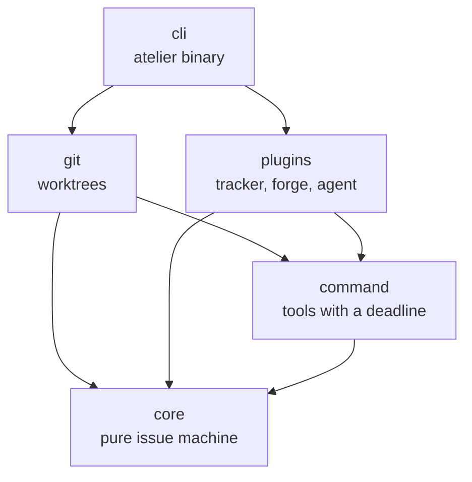

# Crates

The CLI assembles the plugins and owns I/O. The core defines the issue machine
and contracts, with no dependencies or I/O.



## Workspace

| Crate                 | Responsibility                                    | Status         |
| --------------------- | ------------------------------------------------- | -------------- |
| `cli`                 | The `atelier` binary: init, add, daemon, status   | Built, slice 1 |
| `core`                | Issue machine and plugin contracts                | Built, slice 1 |
| `command`             | Running a tool with a deadline and bounded output | Built, slice 1 |
| `git`                 | Worktrees and branches behind core's contract     | Built, slice 1 |
| `../plugins/commands` | Gates a project lists as commands                 | Built, slice 2 |
| `../plugins/github`   | GitHub tracker and forge                          | Built, slice 1 |
| `../plugins/opencode` | OpenCode sessions and permissions                 | Built, slice 1 |

Language plugins enter the workspace with their own slices.

```sh
cargo run --locked -p atelier-cli -- --version
# atelier 0.1.0-rc.8
```

## Rules

- Every member inherits the workspace version, edition, license and lints.
- The minimum is `rust-version` in the root `Cargo.toml`'s
  `[workspace.package]` (`1.100`); every crate inherits it, and the `msrv`
  gate reads and checks it. Development and CI pin stable `1.100.0`.
  The cleanups 1.100 allows are planned in
  [#82](https://github.com/wrkhse/atelier/issues/82).
- Core depends only on [rungs](https://github.com/wrkhse/rungs) and performs
  no I/O. Concrete tools stay outside it.
- Functions contain at most 70 nonblank, noncomment lines.
- Failures are values; production paths contain no unwraps, expects or panics.
- Each thread, queue, resource and external call has a limit and an owner.
- Cleanup that must happen (ending a process group, a durable step folder,
  releasing a queue reservation) is an explicit call that returns its error,
  never a `Drop` or `DropGuard`, since no `Drop` runs after a `SIGKILL`.
- A module with several concepts becomes a directory, one file per concept,
  with a README explaining the flow and usage.

## Checks

The gate commands live in `.atelier/config.toml`; the
[CI runner](https://github.com/wrkhse/atelier/tree/main/.github/ci)
describes containment and report validation.
On a developer's Mac only `cargo fmt` runs, as [AGENTS.md](../AGENTS.md) says.

Kani 0.68.0 uses its own `nightly-2026-08-21` toolchain, distinct from the
stable workspace pin. Cargo accepts that nightly for the 1.100 `rust-version`,
but an API stabilized late in 1.100 may be absent. An API used by Kani-compiled
code (`crates/core` and `rungs`) must be available in that nightly or pass a
contained Kani run. The Kani gate targets `atelier-core`; the runner validates
its report as described in the CI reference.

Cargo 1.100 moves intermediate build artifacts; atelier reads only final ones:
`target/<triple>/release/atelier` in releases, `target/release/atelier` in
packaging, and `CARGO_BIN_EXE_atelier` in the CLI tests. The nextest gate
installs 0.9.151, which supports that layout.
