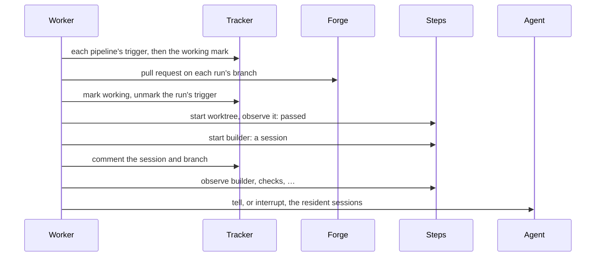

# One poll

A poll asks the plugins what they see of a project, then moves each item's
run: it observes the run's steps through their plugins, turns what they say
into events, and carries out the machine's actions. `observe` only reads;
`act` changes the world, and saves the state after every move and every
action.



| File         | Holds                                                                   |
| ------------ | ----------------------------------------------------------------------- |
| `project.rs` | `Project` with its pipelines, and `Plugins` with each kind of step      |
| `request.rs` | Requests for a pass: finish a running resident step, or stop it         |
| `state.rs`   | `State`, each item's run as a `Record`, and each listing's `Listed` key |
| `trigger.rs` | `triggered`: the pipelines whose trigger an item carries, in order      |
| `observe.rs` | `observe`: listings with their keys, tracked issues, pull requests      |
| `act.rs`     | `act`: each run's events, pending actions, the brief, the `Report`      |

```rust
let observation = observe(&project, &plugins, &state)?;

let report = act(&observation, &mut state, &project, &plugins, &mut |state| store(state))?;
// report.moves → [Move { key: github#12, pipeline: "audit", from: Running,
//                        to: Running, what: "worktree settled passed" }, …]
// report.ambiguous → [(github#13, ["build", "audit"])]: two triggers, no run
```

- **Triggers.** An item asks for a pipeline with that pipeline's trigger
  mark, such as `atelier:audit`; the working and blocked marks are
  atelier's own. A run keeps its own pipeline while it works or has an
  action pending; otherwise it uses the pipeline the item asks for, then
  the one it last ran, then the project's first. A run asked for another
  pipeline starts it with fresh steps, in a new generation.
- **Ambiguity.** An item carrying two pipelines' triggers at once starts
  neither: `act` names them in `Report::ambiguous`, in the project's
  order, and changes no mark. It decides this before a run's events, so an
  item with the working mark, both triggers and no run is reported, not
  blocked as one that lost track. A person takes one trigger off, and the
  next poll starts the other. A working run that gains another trigger
  runs on. A run that stops while the item still carries another
  pipeline's trigger starts that pipeline in the same poll, as a done or
  blocked run does when asked again.
- **Events.** A claim confirms itself. A running run hears its steps first,
  in order: a running step that settled or failed a round, or a settled
  restart step that runs again. Then it hears its item: closed, or without
  the working mark. A run whose steps differ from its pipeline's blocks.
- **Blocked comments.** A comment that asks a person to retry a blocked run
  names the pipeline the run was of, such as `audit`, not the trigger label
  a project gives that pipeline: a project may rename the label, and the
  comment asks for the pipeline's trigger mark again.
- **Resuming.** A move's actions wait in the run's `pending` list, and each
  leaves it once done; a start that made a session leaves its announcement
  in its place. A stop between two actions resumes at the next one; a stop
  right after an action, before its save, repeats it.
- **Cleanup.** Every exit interrupts resident sessions and asks each step's
  plugin to release its own resources, including live command groups. The
  plugin name is kept in the step record even if its pipeline is removed.
- **Failures.** A permanent failure while claiming or starting a step
  blocks the run; any other failure leaves the action pending and is
  reported. The listings' tags are kept only when every item succeeded, so
  a failed item is listed again.
- **Bounds.** One run makes at most 64 moves in a poll.
