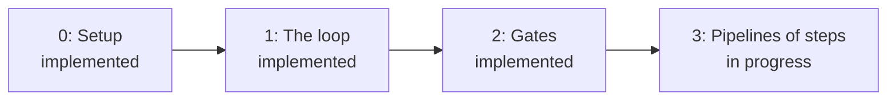

# Slices

atelier ships one usable behavior at a time. The owner reviews each released
slice before the next one starts.

| Slice                                   | Status                    | Plan                           |
| --------------------------------------- | ------------------------- | ------------------------------ |
| 0: Install and run atelier              | Implemented, `0.1.0-rc.2` | [Setup](slices/slice-0.md)     |
| 1: A label becomes a ready pull request | Implemented, `0.1.0-rc.6` | [The loop](slices/slice-1.md)  |
| 2: Run a project's gates                | Implemented, `0.1.0-rc.7` | [Gates](slices/slice-2.md)     |
| 3: Pipelines made of steps              | In progress               | [Pipelines](slices/slice-3.md) |

The [architecture and ordered slice list](https://github.com/wrkhse/atelier/issues/1)
are the approved contract. [GitHub](https://github.com/wrkhse/atelier/issues/6)
and [OpenCode](https://github.com/wrkhse/atelier/issues/7) have separate
plugin plans. Each slice page describes what is built, its Structure and its
checks.

Planned work lives in issues: the [sourcefed trigger](https://github.com/wrkhse/atelier/issues/42),
[Rust](https://github.com/wrkhse/atelier/issues/2),
[TLA+](https://github.com/wrkhse/atelier/issues/3) and
[TypeScript](https://github.com/wrkhse/atelier/issues/4) checks plugins,
the [code map](https://github.com/wrkhse/atelier/issues/5), and the
[remaining pipeline acceptance](https://github.com/wrkhse/atelier/issues/43).
