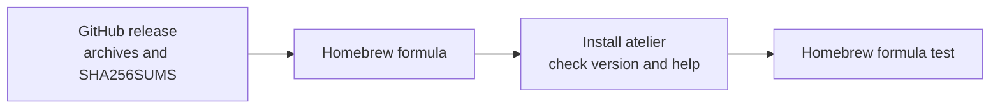

# Slice 0: install and run atelier

**Status: Implemented, `0.1.0-rc.2`.** The candidate installs through Homebrew
and passes its real formula test.

You can install atelier and check its version. The
[project README](../../../README.md) shows the setup flow for using atelier.

## Recording

The Homebrew-installed candidate prints its version and help in the left pane.
The right pane shows the real Homebrew test executing that installed binary;
the shell reports exit status 0. Slice 0 has no daemon or model session.

The terminal-control capture runs in a scratch repository with isolated XDG
configuration and state. The GIF is 1600 pixels wide, 10.4 seconds and 162 KB.
Frames from its beginning and final result are inspected for private data.

## What it builds

### Workspace and command

The workspace builds the `atelier` binary. The
[crates reference](../../../crates/README.md) describes its members and
toolchain; the [CLI reference](../../../crates/cli/README.md) describes its
commands.

Verification: native packaging smoke tests run the binary's version and help.
Pull request gates run in [contained CI](../../../.github/ci/README.md).

### Candidate and Homebrew service

The candidate release provides native archives and a Homebrew formula with a
service definition. [Release tooling](../../../scripts/README.md) describes
packaging, formula generation and verification.

Verification: the release run builds and smoke-tests each target. The protected
tap job audits, installs and tests the formula before publication.

## End to end

- [Pull request #8](https://github.com/wrkhse/atelier/pull/8) and
  [the formula fix](https://github.com/wrkhse/atelier/pull/9)
  pass the pull-request gates.
- [The release commit's Check run](https://github.com/wrkhse/atelier/actions/runs/43021461460)
  passes formatting, lint, tests, MSRV and packaged smoke checks.
- [The candidate release](https://github.com/wrkhse/atelier/releases/tag/v0.1.0-rc.2)
  contains three native archives and SHA256SUMS.
- [The complete Release run](https://github.com/wrkhse/atelier/actions/runs/43021654905)
  passes all three native builds and smoke tests, then the owner-approved tap
  job: style, strict online audit, install, test and formula publication.
- The local Apple Silicon install through `StevenJPx2/taps/atelier` reports
  `atelier 0.1.0-rc.2`; `brew test --verbose StevenJPx2/taps/atelier` exits 0.
  Linux binaries are smoke-tested on their native CI runners; a Linux Homebrew
  install is not part of the local proof.
- `brew services info atelier --json` reports `running: false` and
  `loaded: false`. Its command is `atelier daemon`, with logs in Homebrew's
  `var/log/atelier.log`.
- Eight Mermaid fences across the changed Markdown pages render in GitHub's
  actual preview. The recording's format, width and size are checked by ffprobe.

Local Homebrew's RuboCop plugin emits an upstream obsolete-configuration warning
about `IgnoredPatterns`. No formula offense is reported, and no warning is
suppressed. The protected CI style and strict online audit gates pass.
