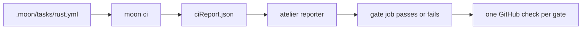

# Slice 1: Rust gate presets on moon

Status: In progress. The approved plan is
[#87](https://github.com/wrkhse/atelier/issues/87), slice 1 of
[#1](https://github.com/wrkhse/atelier/issues/1). The presets, reporter and
wiring are built in this slice; install and usage instructions follow the first
release candidate.

## You can

A Rust monorepo inherits atelier's gate presets and gets one GitHub check per
gate on each pull request. Gates run in CI or a container; the same command runs
locally in a container.

```sh
moon ci
# → one result per gate: rust/fmt, rust/clippy, rust/mutants, …
```



## What it builds

### The preset

A plain task file at `.moon/tasks/rust.yml` names fmt, clippy, test, Kani,
miri, cargo-mutants and MSRV as moon tasks, with `runInCI` set to `always`. It
is seeded from the gate list in `.atelier/config.toml` at f687307 and stays
independent of the reporter. moon 2.6.5 is pinned in `.prototools`.

Usage: a project maps itself in `.moon/workspace.yml` and inherits the tasks;
`moon ci` runs them.

Verification: a fixture Rust workspace passes every gate, and one deliberate
violation per gate fails only that gate.

### The reporter

A Rust binary at `reporter/` reads moon's `ciReport.json`, fails closed when a
gate's result is missing, empty, malformed or failed, and writes the job
summary. Each gate is its own CI job, and the job's status is the check. No job
creates checks through an API or holds a write token. The fail-closed rules are
ported from the report validation in `.github/ci/reports.py` at f687307.

Usage:

```sh
atelier-reporter --report .moon/cache/ciReport.json --gate rust/fmt
```

Verification: a recorded moon result makes its gate job pass or fail; a missing
or invalid result fails it. Unit and integration tests with a stand-in report
prove it.

### Project wiring

`.github/workflows/gates.yml` installs the pinned moon and Rust tools, builds
the reporter and runs `moon ci` inside the bounded non-root container from
`.github/ci`. The gate job's status is the check, and no job has a write token.
A fresh offline container validates the report. No gate runs on a developer's
machine.

Verification: on a fixture pull request every Rust gate is its own check, a
deliberate violation fails its gate, and restoring the code passes it.

## End to end

The fixture pull request runs all seven gates in CI, each gate's job reports its
own check, a deliberate violation fails only its gate, and restoring the code
passes it. The released candidate is recorded working end to end before
review.
