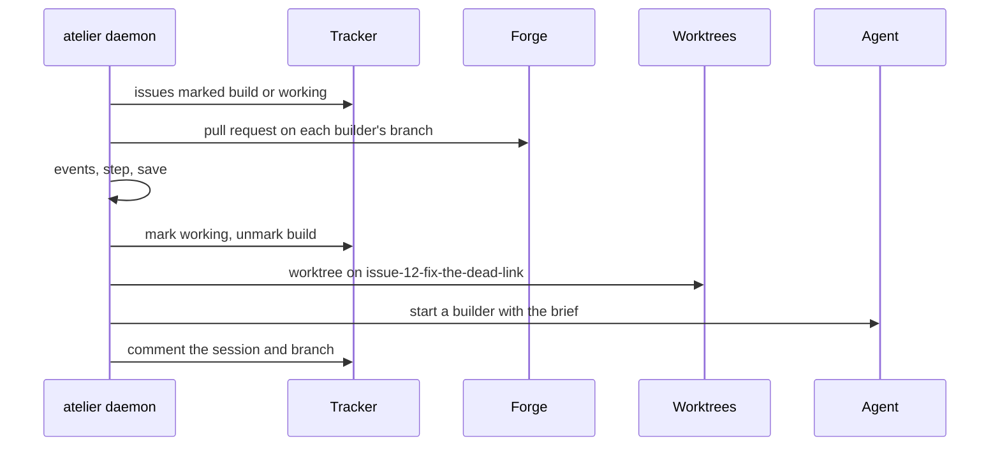

# Slice 1: a label becomes a ready pull request

**Status: Implemented, `0.1.0-rc.6`.** The core, `crates/git`, the `github`
plugin ([#6](https://github.com/wrkhse/atelier/issues/6)), the `opencode`
plugin ([#7](https://github.com/wrkhse/atelier/issues/7)), and the CLI and
daemon are released, and the [end-to-end runs](#end-to-end) on atelier and
Chauffeur pass. `0.1.0-rc.8`, the current release, runs this loop as
described here. On `main` the same loop is the built-in `build` pipeline of
[slice 3](slice-3.md).

You can label an issue `atelier:build` in a watched project and, within a
poll, find a builder working on it in its own worktree. It opens a draft pull
request, fixes what CI reports, and marks it ready once atelier tells it every
check passed.

```sh
atelier add StevenJPx2/chauffeur

gh issue edit 12 --add-label atelier:build
# a poll later: atelier:working, and a comment naming the session and branch
```



## Recording

The Homebrew service, `0.1.0-rc.3`, claims a real issue: atelier
[#16](https://github.com/wrkhse/atelier/issues/16) is labelled
`atelier:build` in the left pane, and the right pane follows the daemon's
log. That release runs git in the project's checkout in `~/Documents`, so
under launchd it waits on macOS's folder prompt; once it is allowed, the next
poll claims the issue and starts a builder. The left pane then shows the
swapped labels, the comment naming the session and branch, and the worktree
on its branch. The current release works only from
[its own clones](#worktrees-cratesgit), so no prompt appears.

The terminal-control capture is the real service and the real issue, with the
wait for the prompt sped up 2400 times. The GIF is 1200 pixels wide, 47.8
seconds and 966 KB. Frames from its beginning, middle and end are inspected for
private data.


## What it builds

### The loop (`crates/core`)

One poll observes each tracker's issues marked build or working and the
forge's pull request on each builder's branch, turns what it sees into
events, and steps each issue through a pure machine. Every step and every
action is saved before the next one runs, so a stopped daemon resumes where it
was. The machine's rules that the runs below depend on:

- Passing checks wake the builder with one message, since sourcefed
  suppresses them and nothing else would tell it to mark the pull request
  ready.
- Removing `atelier:working` or closing the issue interrupts the builder and
  tells it to stand down, since its pull request's events still wake it.
- Five failed CI rounds, by default, block the issue: `atelier:blocked` replaces
  `atelier:working`, with a comment saying why.
- A merge closes the issue and removes the worktree.

Files: [`machine/`](../../../crates/core/src/machine/README.md),
[`poll/`](../../../crates/core/src/poll/README.md) and
[`roles/`](../../../crates/core/src/roles/README.md), whose READMEs hold the
types and invariants, and the builder's contract in
[`prompts/builder.md`](../../../crates/core/prompts/builder.md).

Verified by Kani over every phase and event of the machine, poll tests against
an in-memory tracker, forge, agent and worktrees (one builder across many
polls, a stop after every save resuming to the same end, transient and
permanent failures), and mutation testing.

### Worktrees (`crates/git`)

atelier keeps its own bare clone of each project under
`~/.local/share/atelier/clones`, and a worktree for each issue under
`~/.local/share/atelier/worktrees`, on the issue's branch
`issue-<id>-<slug>`. Neither is in a folder macOS guards, so the daemon never
waits on a prompt. A local branch is never reset, so a builder started again
continues its work.

Files: [`crates/git/`](../../../crates/git/README.md). Verified against real
repositories: a bare `origin` and atelier's clone of it.

### The `github` plugin (`plugins/github`)

GitHub as tracker and forge, through `gh` and the user's own sign-in. Each
mark is a label a project can rename, a listing sends its ETag so an
unchanged repository costs a 304, and the forge reads the pull request and its
failed rounds in one GraphQL query. The builder may not run `gh pr merge` or
`gh release`.

Files: [`plugins/github/`](../../../plugins/github/README.md). Verified with
a stand-in `gh` replaying replies captured from GitHub, and one test against
the real GitHub when `gh` is signed in.

### The `opencode` plugin (`plugins/opencode`)

Each builder is an ordinary OpenCode session in its worktree, open in the TUI
to watch or talk to. The brief's denials become the session's permission
rules, so it refuses them without asking anyone, and it may push only to its
own branch.

Files: [`plugins/opencode/`](../../../plugins/opencode/README.md). Verified
with a stand-in `opencode` replaying OpenCode v2.2.7, and once against the
real OpenCode: a session told to run `git push origin main`,
`gh pr merge 999999` and `git push origin issue-1-live` is refused the
first two with `Permission denied: shell`, `origin`'s `main` is unchanged,
and its own branch is pushed.

### The CLI and daemon (`crates/cli`)

The `atelier` binary: `init`, `add`, `daemon` and `status`. Each watched
project polls on its own thread, every 30 s by default and at least every
15 s. Apart from that interval, the daemon rereads `projects.toml` every 5 s,
so a project `atelier add` names starts polling within seconds. One writer
owns `state.json`, and a lock lets one daemon run. Each project's
`.atelier/config.toml` is read from `origin`, so a branch cannot change its
limits.

Files: [`crates/cli/`](../../../crates/cli/README.md), the reference for
every command, setting and timing.

Verified by tests that run the real binary with real git and stand-ins for
`gh` and `opencode`: a labelled issue gets one builder across polls and a
restart, with one comment; a second daemon refuses to start; an issue assigned
to someone else is left alone under your filter; and `add` makes a bare clone
and refuses a repository it cannot reach.

## End to end

Each run is a real issue on GitHub, labelled with the owner's approval, and
followed by the Homebrew service, as
[the plan](https://github.com/wrkhse/atelier/issues/1#end-to-end) lists.

| Run                                                                                                                     | What happens                                                                                                                                                                                                                                                                                                      |
| ----------------------------------------------------------------------------------------------------------------------- | ----------------------------------------------------------------------------------------------------------------------------------------------------------------------------------------------------------------------------------------------------------------------------------------------------------------- |
| [atelier#16](https://github.com/wrkhse/atelier/issues/16) → [#17](https://github.com/wrkhse/atelier/pull/17)            | Claimed within a poll. The builder's pull request fails mutation testing; the failure reaches it through sourcefed, it fixes the cause, and the next push passes. The merge closes the issue and removes the worktree.                                                                                            |
| [atelier#19](https://github.com/wrkhse/atelier/issues/19)                                                               | Removing `atelier:working` mid-turn stops the builder within a poll: its turn is aborted and nothing is pushed.                                                                                                                                                                                                   |
| [atelier#20](https://github.com/wrkhse/atelier/issues/20) → [#21](https://github.com/wrkhse/atelier/pull/21)            | Five red rounds block the issue: `atelier:blocked` replaces `atelier:working`, atelier comments why, and the builder stands down.                                                                                                                                                                                 |
| [chauffeur#6](https://github.com/wrkhse/chauffeur/issues/6) → [chauffeur#8](https://github.com/wrkhse/chauffeur/pull/8) | Chauffeur's whole config is `base = "v2"`: the worktree starts from `origin/v2` and the pull request goes into `v2`. The site build and every check pass; atelier tells the builder, which marks it ready 18 seconds later. The merge into `v2`, not the default branch, still closes the issue, through atelier. |

The runs shape three parts of the design. sourcefed suppresses passing
checks, so atelier tells the builder when every check passed
([#18](https://github.com/wrkhse/atelier/pull/18)). A pull request's
events still wake an interrupted builder, so atelier tells it to stand down
([#22](https://github.com/wrkhse/atelier/pull/22)). And under launchd,
git in a checkout in `~/Documents` waits on macOS's folder prompt, which
each release brings back, so the daemon works only from
[its own clones](https://github.com/wrkhse/atelier/issues/1#ateliers-own-clones).
