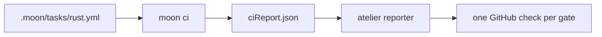

# Slice 1: Rust gate presets on moon

Status: In progress. The approved plan is
[#87](https://github.com/wrkhse/atelier/issues/87), slice 1 of
[#1](https://github.com/wrkhse/atelier/issues/1). The presets, reporter and
wiring are built in this slice; install and usage instructions follow the first
release candidate.

## You can

A Rust monorepo inherits atelier's gate presets and gets one GitHub check per
gate on each pull request. Gates run in CI or a container; the same command runs
locally in a container.

```sh
moon ci
# → one result per gate: rust/fmt, rust/clippy, rust/mutants, …
```



## What it builds

### The preset

A plain task file at `.moon/tasks/rust.yml` names fmt, clippy, test, Kani,
miri, cargo-mutants and MSRV as moon tasks, with `runInCI` set to `always`. It
is seeded from the gate list in `.atelier/config.toml` at f687307 and stays
independent of the reporter. moon 2.6.5 is pinned in `.prototools`.

Usage: a project maps itself in `.moon/workspace.yml` and inherits the tasks;
`moon ci` runs them.

Verification: a fixture Rust workspace passes every gate, and one deliberate
violation per gate fails only that gate.

### The reporter

A Rust binary at `reporter/` reads moon's `ciReport.json` and creates one
GitHub check per gate through the `gh` CLI. It maps a moon task result by the
target's task id, turns passed or cached results into a passing check, and
turns a failed, missing, malformed or oversized result into a failing check.
The fail-closed rules and their tests are ported from `.github/ci/reports.py`
and `test_reports.py` at f687307.

Usage:

```sh
atelier-reporter \
  --report .moon/cache/ciReport.json \
  --gate rust/fmt --gate rust/clippy \
  --repo wrkhse/atelier --sha "$GITHUB_SHA"
```

With `--validate-only` the binary judges the report without a token, for the
offline validation container.

Verification: a recorded moon result produces exactly one check per gate; a
missing result fails its gate. Tests cover every mapping and failure mode with a
stand-in `gh`.

### Project wiring

`.github/workflows/gates.yml` installs the pinned moon and Rust tools, builds
the reporter, runs `moon ci` inside the bounded non-root container from
`.github/ci`, then publishes the checks on the runner with a token. A fresh
offline container validates the report before publication. No gate runs on a
developer's machine.

Verification: on a fixture pull request every Rust gate is its own check, a
deliberate violation fails its gate, and restoring the code passes it.

## End to end

The fixture pull request runs all seven gates in CI, the reporter posts one
check per gate, a deliberate violation fails only its gate, and restoring the
code passes it. The released candidate is recorded working end to end before
review.
