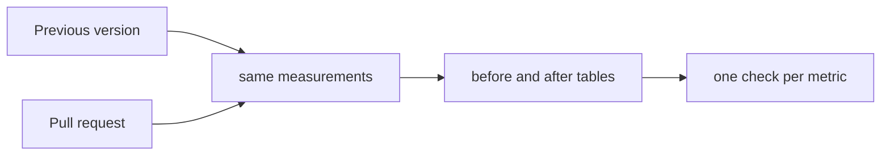

# Slice 2: Metrics against the previous version

Status: Planned. The approved plan is
[#88](https://github.com/wrkhse/atelier/issues/88), slice 2 of
[#1](https://github.com/wrkhse/atelier/issues/1).

## You can

A project using atelier's presets sees, on every pull request, how the change
compares with the version before it: speed, resource use and complexity. Each
metric is its own GitHub check with a before and after table. For example, a
function that grows by five percent fails the instruction check while its
resource table still passes.

## What it builds

### Performance

Instruction counts are the stable measure and can fail a check. A metrics
crate and a container job handle each measure. CI runs the same benchmark on
base and head in separate contained jobs and compares them. Head supplies its
measured counts read-only to the trusted job. It cannot write the base
measurement, saved baseline, limits, summary or verdict.
Gungraun 0.20.0 measures instructions with Callgrind, and the limit comes
from `.moon/config/metrics.toml`.

Wall-time percentiles from hyperfine are planned: they are reported, never
failing, and arrive after instruction counts.

A benchmark with no counterpart on base is judged against its absolute
budget, and fails closed when it has none. A base without the benchmark
harness is a named failure.

The gate catches regressions in honest code. It does not defend against a
pull request that games its own measurement, any more than the test gate
defends against one that rewrites its tests; that gaming is the review bot's
gaming digest and the owner's concern (supervisor, 2026-11-26).

Verification: the deliberate-slowdown proof patches `results()` with a real
loop and fails the instruction check; the unpatched code passes.

### Resources

Resources appear in a before-and-after table and never fail a check. Each row
names its method:

- hyperfine 2.0.0 supplies CPU time (`time_user` plus `time_system`), peak
  memory (`memory_peak_resident`) and `startup_seconds`, its wall-clock
  median. `build_seconds` is the wall clock of `cargo build`, measured around
  the build. Wall-time percentiles are planned; this slice computes no p99.
- Gungraun 0.20.0's DHAT tool supplies allocation bytes and blocks
  (`TotalBytes` and `TotalBlocks`), under a pinned Valgrind of at least 3.20
  that the gate image installs from its official tarball with a verified
  SHA-256.
- cargo-bloat 0.12.1 with `--crates --message-format json` supplies file size
  and an estimated per-crate `.text` breakdown; `cargo metadata` supplies
  dependency facts.
- GNU time reports three rows for the direct child: `Voluntary context
  switches`, `Maximum resident set size (kbytes)` and `File system outputs`.
- A `long_running` declaration in `.moon/config/metrics.toml` names a process
  the gate samples directly in `/proc` every 100 ms. Idle footprint,
  voluntary context switches over the idle window, `wchar` bytes and sampled
  peak threads and open files are numeric for a declared process. An
  undeclared, short-lived command reports `not applicable: exits in N ms` in
  those five rows. The fixture at
  `tests/fixtures/metrics-idle/.moon/config/metrics.toml` declares a
  long-running process for the proof.

No row carries a budget; all are reported only, so none can flake.

Verification: doubled allocations appear in the table and do not fail.

### Complexity

rust-code-analysis-cli 0.0.25 emits cyclomatic, cognitive, Halstead and
maintainability index per function for Rust, TypeScript and JavaScript. The
same binary measures base and head, and the head may not regress.

Verification: a function made more complex fails the ratchet; removing the
change passes.

### Budgets

Each project sets its instruction limit in its preset. The metrics crate
applies it and emits a failing check when a measure exceeds it.

Verification: a limit of +5% fails a +6% change and passes a +4% change.

### The metrics crate

A Rust binary reads recorded measurements from both versions, writes before and
after tables to the job summary, and exits non-zero on a failed budget or
ratchet. It reuses slice 1's check jobs: each job's status is the check.

Verification: unit tests for each comparison and a fixture end-to-end run in
CI.

## End to end

On a fixture monorepo pull request, each metric is its own check with a before
and after table. Every measurement runs in CI inside a bounded container, never
on the host.

## Decided

| Question            | Decision                                                |
| ------------------- | ------------------------------------------------------- |
| Performance measure | Instruction counts, the stable measure                  |
| Failing metrics     | Instruction budgets and complexity ratchet              |
| Resources           | Reported, never failing                                 |
| Complexity tool     | rust-code-analysis-cli                                  |
| Benchmark runner    | Gungraun 0.20.0 with Callgrind                          |
| Wall time           | hyperfine 2.0.0                                         |
| Binary size         | cargo-bloat 0.12.1                                      |
| Quality guards      | cargo-deny, cargo-geiger, cargo-llvm-cov, cargo-mutants |
