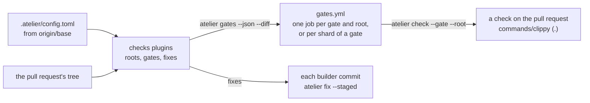

# Slice 2: run a project's gates

**Status: Implemented, `0.1.0-rc.7`.** Every part is released, atelier
checks itself with its own gates, and the [end-to-end runs](#end-to-end) on
atelier and on a fixture repository pass. `0.1.0-rc.8` is the current
release.

You can see every gate a project runs, run them yourself, and have GitHub run
each as its own check on a pull request. Every commit a builder makes is
already formatted and lint-fixed. A project lists its gates as commands, as
atelier does; checks plugins that find a project's gates by themselves are
planned for [Rust](https://github.com/wrkhse/atelier/issues/2),
[TLA+](https://github.com/wrkhse/atelier/issues/3) and
[TypeScript](https://github.com/wrkhse/atelier/issues/4).

```toml
# .atelier/config.toml
checks = ["commands"]

[commands.clippy]
run = "cargo clippy --workspace --all-targets --locked -- -D warnings"
fix = "cargo clippy --fix --allow-dirty --allow-staged --workspace"

[commands.prettier]
root = "docs"
run = "npx --yes prettier@3.9.10 --check ."
fix = "npx --yes prettier@3.9.10 --write ."
```

```sh
atelier gates
# .     commands/clippy
# docs  commands/prettier

atelier check
# docs  commands/prettier  fail     1.6 s
#     [warn] plans/README.md
#     [warn] Code style issues found in the above file. Run Prettier with --write to fix.
```



## Recording

The installed `0.1.0-rc.7`, in a scratch clone of atelier: `atelier gates`
lists its 14 gates. A table that is not formatted is added under `docs/`, so
`atelier check` runs only the docs gate, which fails and prints why;
`atelier fix` fixes the file and the check passes. Last, the fixture
repository's pull request, whose CI is the workflow `atelier init` wrote,
shows each gate as its own check.

The terminal-control capture GIF is 39.9 seconds, 1200 pixels wide and 775 KB.
Frames from its middle and end are inspected for private data.


## What it builds

### The checks role (`crates/core`)

A checks plugin reads a project's tree and returns data: its roots, the
directories its gates run in, and each root's gates and fixes as shell
commands with their setup. Core picks the roots a diff touches, each file
belonging to the deepest root that holds it, and applies the project's
`[paths]` overrides, the deepest matching path winning. It does no I/O, so
it is tested with an in-memory tree.

```toml
# .atelier/config.toml
[paths."vendor"]
checks = []                     # nothing under vendor/ is checked

[paths."tools/codegen"]
skip = ["commands/mutants"]     # generated code
```

Files: [`crates/core/src/checks/`](../../../crates/core/src/checks/mod.rs).

Verified by tests with fixed plugins: a file touches the deepest roots that
hold it, and `docsite/` is not inside `docs`; with no diff every root runs;
an empty diff runs nothing; `checks` and `skip` narrow a subtree; an
override applies per changed file, so `checks = []` empties a subtree even
for a root above it; an unknown plugin name is refused. Mutation testing over
the diff: 68 mutants, 53 caught, 15 unviable.

### The `commands` plugin (`plugins/commands`)

The project names its gates as commands, each with an optional `root`,
`fix` and `setup`, and turns the plugin on in `checks`. A gate is named
`commands/<name>`. `atelier check` puts the base the changes are measured
from in `ATELIER_BASE`, so a gate such as mutation testing can test only
them:

```toml
[commands.mutants]
run = '''
diff=$(mktemp) && git diff "$ATELIER_BASE" > "$diff"
cargo mutants --in-diff "$diff"
'''
```

Files: [`plugins/commands/`](../../../plugins/commands/README.md), the
reference for its keys, names and refusals.

Verified by mutation testing over the diff: 35 mutants, 27 caught, 8
unviable.

### Running gates (`crates/cli`)

`atelier gates`, `check` and `fix` run in a checkout. The gates come from
the project's config as the daemon reads it, from `origin/<base>`, so a pull
request cannot drop the gate it fails; the roots come from the checkout's own
tree, so a new root is checked in the pull request that adds it. `check`
runs the gates the changes since `origin/<base>` touch, committed or not,
and any failure prints the last 40 lines of its output and exits 1.
`atelier fix` runs the fixes on the files given, or the staged ones with
`--staged`, stages them again, and exits 1 when a fix fails.

Files: `crates/cli/src/gates.rs`, `crates/git/src/tree.rs`, and the
[CLI reference](../../../crates/cli/README.md).

Verified through the real binary, in a checkout whose gates are real shell
commands: a change under `docs` plans only the `docs` gate, a failing gate
exits 1 with its output, and a gate added on the branch does not run until it
is on the base. Mutation testing over the diff: 63 mutants, 50 caught, 13
unviable.

### Fixes before each commit (`crates/git`, `crates/cli`)

When atelier makes a builder's worktree, it gives that worktree alone a
pre-commit hook, through Git's per-worktree config, so every commit the
builder makes is already fixed and the builder does nothing for it.

```sh
git -C <worktree> config extensions.worktreeConfig true
git -C <worktree> config --worktree core.hooksPath ~/.local/share/atelier/hooks
```

The daemon writes `~/.local/share/atelier/hooks/pre-commit` at each start.
It runs `atelier fix --staged`, then the project's own pre-commit hook. A
staged file that also has unstaged changes is left as staged, so no unstaged
work slips into the commit. A fix that fails does not stop the commit; the
gate fails in CI instead.

Files: `crates/git/src/worktree.rs`, `crates/cli/src/hook.rs`.

Verified through the real binary: a commit in a builder's worktree, with no
`atelier` on `PATH`, is committed fixed, the project's own hook runs, and
neither the checkout nor the clone gains a hooks folder.

### GitHub's CI (`plugins/github`, `.github/workflows/gates.yml`)

`atelier init` from a release build writes a workflow that calls atelier's
reusable `gates.yml`, pinned to the commit the release was built from:

```yaml
# .github/workflows/atelier.yml
jobs:
  gates:
    uses: wrkhse/atelier/.github/workflows/gates.yml@<commit> # v0.1.0-rc.8
    with:
      atelier: 0.1.0-rc.8
```

`gates.yml` installs atelier from that release, checking its sum, and reads
`atelier gates --json` into a matrix: on a pull request with
`--diff <base commit>`, against the push's `before` commit on a push to the
base, and every root on a first or forced push. It runs
`atelier check --setup --gate <gate> --root <root>` as one job each, named
`commands/clippy (.)`, or as one job per shard of a mutants gate, named
`commands/mutants (.) [1/4]`, so each shows as its own check, and a failure
reaches the builder through sourcefed. The gate job runs with
`fail-fast: false` and full history (`fetch-depth: 0`), and is skipped when
the matrix is empty. With `atelier: source`, it builds atelier from the
calling repository instead, as atelier's own CI does. How each job is
contained, and the reports a gate must leave, is in
[the CI runner](https://github.com/wrkhse/atelier/tree/main/.github/ci).

Files: [`plugins/github/src/ci.rs`](../../../plugins/github/src/ci.rs),
[`.github/workflows/gates.yml`](../../../.github/workflows/gates.yml).

#### Structure

A forge names the files its CI needs to run a project's gates with one
release, on pull requests and on pushes to the base. A release build stamps
its commit through `ATELIER_COMMIT`, which `release.yml` sets; `init`
writes the forge's files only from a release build, and says why when it
writes none.

```rust
pub struct CiFile {
    pub path: String,
    pub text: String,
}

pub trait Forge {
    fn ci(&self, release: &str, commit: &str, base: &str) -> Vec<CiFile>;
    …
}
```

`gates.yml` has five jobs, `image`, `plan`, `gate`, `gate-tools` and
`partition`, with `image` building and publishing the one container image
that `gate-tools` and `partition` pull by digest. `plan` installs atelier
once, from the release with its `SHA256SUMS` checked or built from source,
passes it on as an artifact, and writes the matrix, with each mutants gate
split into one entry per shard. `gate` runs once per entry, without stopping
the others on a failure; it is skipped when the matrix is empty.
`gate-tools` is the same job for the gates whose setup installs a tool, and
it runs them in the image the run published. `partition` runs after the
gates, also when one failed, and in a fresh offline container proves that
every shard's report is there and that no mutant is tested twice and none is
left out. `plan` and `gate` check out the full history without stored credentials,
since atelier fetches the base branch to read the config.

#### Verification

The github plugin's workflow names the base, the pinned commit and the
release; `init` from a build with no release commit writes no CI and says
so; `write_ci` writes each file in its folder. `actionlint` passes on
`gates.yml`, on `release.yml` and on a written `atelier.yml`. The
workflow runs for real on atelier's own pull requests and in the end to end.

### atelier checks itself (`.atelier/config.toml`)

atelier lists its 14 gates as commands in
[`.atelier/config.toml`](../../../.atelier/config.toml), and its CI calls
`gates.yml` from its own tree with `atelier: source`, so a pull request that
changes `gates.yml` runs it as changed. The gates themselves come from
`main`'s config, as for any project. In `.`, only `fmt` has a fix, so a
builder's commit is formatted without waiting on a build.

Verified with the real binary in a copy of atelier whose `main` holds the
config: `gates` lists the 14 gates, and `fmt`, `readmes`, `prettier`,
`ruff` and `actionlint` pass; a change under `docs` alone plans only
`commands/prettier (docs)`. Then on a pull request to atelier, one check
per gate and root, or per shard of the mutants gate.

## End to end

Each run is real: atelier's own pull requests, an issue labelled with the
owner's approval and followed by the Homebrew service, and a public fixture
repository created for the check.

| Run                                                                                                          | What happens                                                                                                                                                                                                                                                                                                                                           |
| ------------------------------------------------------------------------------------------------------------ | ------------------------------------------------------------------------------------------------------------------------------------------------------------------------------------------------------------------------------------------------------------------------------------------------------------------------------------------------------ |
| atelier's checkout                                                                                           | `atelier gates` lists the 14 gates of `.atelier/config.toml`; `atelier check` runs only the gates the changes touch.                                                                                                                                                                                                                                   |
| [#35](https://github.com/wrkhse/atelier/pull/35), [#36](https://github.com/wrkhse/atelier/pull/36)           | #35 touches only `.github`, `docs` and `scripts`, and runs only their three gates. #36 touches the code and runs every gate, each as its own check, all passing.                                                                                                                                                                                       |
| [atelier#37](https://github.com/wrkhse/atelier/issues/37) → [#38](https://github.com/wrkhse/atelier/pull/38) | The builder writes `pub   const   E2E_HOOK :   u8 = 1 ;` and its commit holds `pub const E2E_HOOK: u8 = 1;`: the hook formatted it. A table row it was asked to leave as written fails `commands/readmes (.)`, which reaches it through sourcefed; it fixes the row, every gate passes, and atelier tells it so, 12 seconds before it marks #38 ready. |
| A fixture repository's first pull request                                                                    | `atelier init` from the `0.1.0-rc.7` release writes `atelier.yml` pinned to the release's commit. Its pull request installs that release, its sum checked; `commands/todo (notes)` fails on a TODO beside a passing `commands/readme (.)`, then passes after the fix.                                                                                  |

The first full run on `main` found a fault in the runs themselves: the
command runner closed a tool's output after its first MiB, so kani, which
prints more, was stopped on its next write, and the failure's reason was
never kept. Each output is read to its end and its last MiB kept
([#36](https://github.com/wrkhse/atelier/pull/36)).
