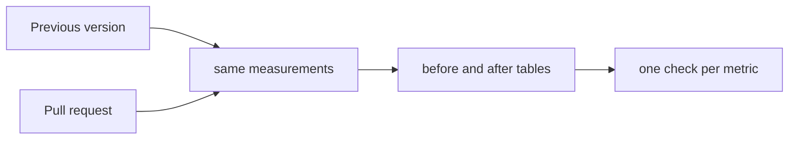

# Slice 2: Metrics against the previous version

Status: Planned. The approved plan is
[#88](https://github.com/wrkhse/atelier/issues/88), slice 2 of
[#1](https://github.com/wrkhse/atelier/issues/1).

## You can

A project using atelier's presets sees, on every pull request, how the change
compares with the version before it: speed, resource use and complexity. Each
metric is its own GitHub check with a before and after table. For example, a
function that grows by five percent fails the instruction check while its
resource table still passes.

## What it builds

### Performance

Instruction counts from Gungraun with Callgrind are the stable measure and can
fail a check; wall-time percentiles from hyperfine are reported. It lives in a
metrics crate and a container job for each measure. One CI job runs the same
benchmark on base and head and compares them.

Verification: a deliberate slowdown fails the instruction check; removing it
passes.

### Resources

CPU time, peak memory, allocations, binary size and dependency facts appear in
a table and never fail a check. hyperfine 2.0.0 reports wall time and peak RSS,
Gungraun's DHAT tool reports allocations, cargo-bloat 0.12.1 breaks down binary
size, and GNU time and `/proc` report the rest.

Verification: doubled allocations appear in the table and do not fail.

### Complexity

rust-code-analysis-cli 0.0.25 emits cyclomatic, cognitive, Halstead and
maintainability index per function for Rust, TypeScript and JavaScript. The
same binary measures base and head, and the head may not regress.

Verification: a function made more complex fails the ratchet; removing the
change passes.

### Budgets

Each project sets its instruction limit in its preset. The metrics crate
applies it and emits a failing check when a measure exceeds it.

Verification: a limit of +5% fails a +6% change and passes a +4% change.

### The metrics crate

A Rust binary reads recorded measurements from both versions, writes before and
after tables to the job summary, and exits non-zero on a failed budget or
ratchet. It reuses slice 1's check jobs: each job's status is the check.

Verification: unit tests for each comparison and a fixture end-to-end run in
CI.

## End to end

On a fixture monorepo pull request, each metric is its own check with a before
and after table. Every measurement runs in CI inside a bounded container, never
on the host.

## Decided

| Question            | Decision                                                |
| ------------------- | ------------------------------------------------------- |
| Performance measure | Instruction counts, the stable measure                  |
| Failing metrics     | Instruction budgets and complexity ratchet              |
| Resources           | Reported, never failing                                 |
| Complexity tool     | rust-code-analysis-cli                                  |
| Benchmark runner    | Gungraun 0.20.0 with Callgrind                          |
| Wall time           | hyperfine 2.0.0                                         |
| Binary size         | cargo-bloat 0.12.1                                      |
| Quality guards      | cargo-deny, cargo-geiger, cargo-llvm-cov, cargo-mutants |
