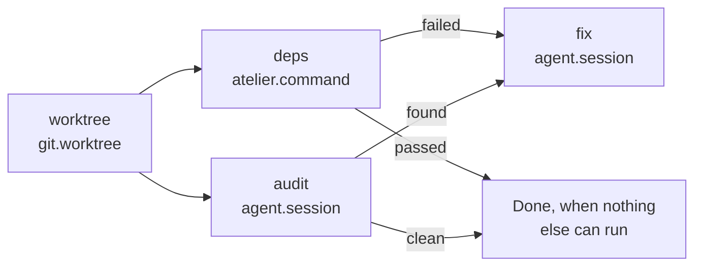
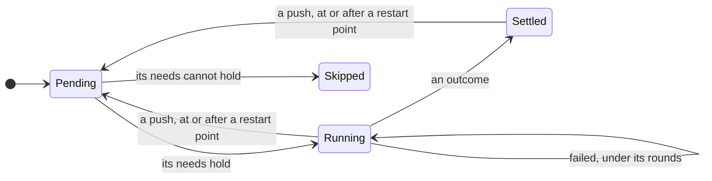
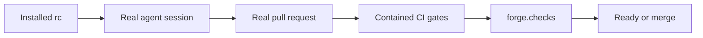

# Slice 3: pipelines made of steps

**Status: In progress.** The plan is
[#43](https://github.com/wrkhse/atelier/issues/43), slice 3 of
[#1](https://github.com/wrkhse/atelier/issues/1). The `sourcefed` trigger
follows as slice 4 ([#42](https://github.com/wrkhse/atelier/issues/42)).
Pipelines run on [rungs](https://github.com/wrkhse/rungs) `v0.1.0`, and
an earlier rc's `state.json` is read into runs of `build`. Agents settle
their steps with `atelier finish`, and a person stops a run with
`atelier stop`.

## You can

Give a project any number of pipelines, each a set of steps written in its
config. A step can be one a plugin provides, an agent with your own prompt, or a
shell command. Each step says which earlier outcomes it waits for, and steps
whose needs are met together run at the same time. Today's loop, from an issue
to a merged pull request, becomes the `build` pipeline, written in the same
terms.

For example, atelier adds `security-audit`. Labelling an issue
`atelier:security-audit` makes a worktree. Then `cargo deny` and an agent
following the audit prompt run side by side. If either finds something, a second
agent fixes it in a pull request. If both come back clean, the run is Done and
the issue closes with what was checked.

```toml
# atelier's .atelier/config.toml
[[pipeline.security-audit.step]]
id = "worktree"
uses = "git.worktree"

[[pipeline.security-audit.step]]
id = "deps"
uses = "atelier.command"
run = "cargo deny check advisories"
after = ["worktree"]

[[pipeline.security-audit.step]]
id = "audit"
uses = "agent.session"
prompt = ".atelier/prompts/security-audit.md"
outcomes = ["found", "clean"]
after = ["worktree"]

[[pipeline.security-audit.step]]
id = "fix"
uses = "agent.session"
prompt = ".atelier/prompts/fix-findings.md"
outcomes = ["opened"]
after_any = { audit = "found", deps = "failed" }
```



## What it builds

### Steps

Every step has the same shape:

| Key           | Meaning                                                                                                               | Default            |
| ------------- | --------------------------------------------------------------------------------------------------------------------- | ------------------ |
| `id`          | Its name in this pipeline                                                                                             | required           |
| `uses`        | The step kind, `<namespace>.<kind>`                                                                                   | required           |
| `after`       | Steps it waits for. A list means each of them passed; a table names the outcome each must have, or a list of outcomes | the step before it |
| `after_any`   | As `after`, but one is enough                                                                                         | none               |
| `outcomes`    | The outcomes it can settle with, besides `failed`                                                                     | the kind's own     |
| `rounds`      | How many times it may fail before the failure is final                                                                | 1                  |
| `restart`     | A push sends the run back here                                                                                        | false              |
| anything else | The kind's own settings, such as `prompt` or `run`                                                                    |                    |

- **`uses` names a role or a plugin.** `agent.session`, `forge.checks` and
  `tracker.comment` go to whichever plugin fills that role in the project, so a
  committed config works with any agent or forge. `opencode.session` or
  `github.checks` name one plugin, for a step that only works there. `atelier.*`
  are core's own kinds.
- **A step waits until every step it names has settled or been skipped,** then
  runs if its needs hold and is skipped if they don't. Steps that become ready
  together start together.
- **A failed step under its `rounds` starts again.** Its final failure goes to
  any step that names `failed` in its needs; if none does, the run blocks.
- **A run is Done** when no step is running and none can start. It closes the
  work item with a comment listing each step's outcome.
- **Resident steps,** an agent's session, stay alive after they settle, so later
  steps can talk to them, as `forge.ready` tells the builder every check passed.
  Every way out of a run interrupts them and tells them why.
- **Config is checked when it loads.** An unknown kind, a cycle, `after` naming
  a later or unknown step, an outcome the step can't settle with, or more than 8
  steps each refuse the pipeline with its name and the reason:
  `security-audit: no step kind "forge.reviews"; github has checks, ready, merge`.

#### Structure

`Pipeline::read` reads one pipeline from its steps' settings, each a
`[[pipeline.<name>.step]]` table, and checks it against the kinds the project
can use. A step with neither `after` nor `after_any` waits for the step before
it to pass; `after = []` waits for nothing. Each step's other keys go to its
kind's plugin, which checks them and returns them as the step runs with them.
A pipeline's name, each id and each outcome take letters, digits, `-` and `_`;
`rounds` is 1 to 255.

```rust
pub const MAX_STEPS: usize = 8;
pub const PASSED: &str = "passed";
pub const FAILED: &str = "failed";

pub struct Pipeline {
    name: String,
    steps: Vec<StepSpec>,
}

impl Pipeline {
    pub fn read(
        name: &str,
        steps: &[Settings],
        kinds: &Kinds<'_>,
        tree: &dyn Tree,
    ) -> Result<Self, PipelineError>;
    pub fn name(&self) -> &str;
    pub fn steps(&self) -> &[StepSpec];
    pub fn step(&self, id: &str) -> Option<&StepSpec>;
}

pub struct PipelineError {
    pub pipeline: String,
    pub problem: String,
}
```

A checked step keeps the kind as written and the plugin it resolved to, so
`atelier status` shows `forge.checks` as `github.checks`.

```rust
pub struct StepSpec {
    pub id: String,
    pub uses: String,
    pub plugin: &'static str,
    pub kind: String,
    pub needs: Needs,
    pub outcomes: Vec<String>,
    pub rounds: u8,
    pub restart: bool,
    pub resident: bool,
    pub settings: Settings,
}

impl StepSpec {
    pub fn resolved(&self) -> String;
}

pub struct Needs {
    pub all: Vec<Need>,
    pub any: Vec<Need>,
}

pub struct Need {
    pub step: String,
    pub outcomes: Vec<String>,
}
```

`Kinds` holds each namespace and the plugin behind it. The registry puts each
plugin's kinds under its own name, and the project's agent, forge and only
tracker under `agent`, `forge` and `tracker`; with no agent named, the
build's only agent fills the role.

```rust
pub struct Kinds<'a> {
    namespaces: Vec<Namespace<'a>>,
}

impl<'a> Kinds<'a> {
    pub fn with(
        self,
        namespace: &str,
        plugin: &'static str,
        step: &'a dyn Step,
    ) -> Self;
}

impl<'a> Registry<'a> {
    pub fn step(&mut self, step: &'a dyn Step);
    pub fn kinds(
        &self,
        agent: Option<&str>,
        forge: &str,
        trackers: &[&str],
    ) -> Kinds<'a>;
}
```

A step's settings are read with `Settings`' typed getters, which name the key
of any value of the wrong type, such as `checks.rounds: must be a number`.

```rust
impl Settings {
    pub fn get(&self, key: &str) -> Option<&Setting>;
    pub fn number(&self, path: &str, key: &str)
        -> Result<Option<i64>, SettingsError>;
    pub fn flag(&self, path: &str, key: &str)
        -> Result<Option<bool>, SettingsError>;
    pub fn without(&self, keys: &[&str]) -> Self;
}
```

### Step kinds

| Kind              | From                        | Starts by                                                                                                                                                  | Settles                                                                   |
| ----------------- | --------------------------- | ---------------------------------------------------------------------------------------------------------------------------------------------------------- | ------------------------------------------------------------------------- |
| `git.worktree`    | `git`                       | creating the run's worktree from `origin/<base>`                                                                                                           | `passed` when it exists                                                   |
| `agent.session`   | the agent role (`opencode`) | starting a resident session with `prompt`, read from `origin/<base>`, or `brief = "builder"`, core's builder contract with the tracker's and forge's parts | when the agent runs `atelier finish <outcome> "<why>"`                    |
| `atelier.command` | core                        | running `run` in the worktree, with a time limit                                                                                                           | `passed` on exit 0, otherwise `failed`                                    |
| `forge.checks`    | the forge role (`github`)   | nothing: CI runs on each push                                                                                                                              | `passed` when every check on the head passed, `failed` for a failed round |
| `forge.ready`     | the forge role              | telling the resident agent every check passed                                                                                                              | `passed` when the pull request is marked ready                            |
| `forge.merge`     | the forge role              | nothing: a person merges                                                                                                                                   | `merged`, or `failed` when closed unmerged                                |

A plugin adds kinds through the new `Step` role:

```rust
pub trait Step {
    /// The kinds this plugin offers, such as "checks" for "github.checks".
    fn kinds(&self) -> Vec<Kind>; // name, outcomes, resident

    /// Checks the step's own settings when the config loads; `tree` is the
    /// project at origin/<base>, where `prompt` names a file.
    fn configure(
        &self,
        kind: &str,
        settings: &Settings,
        tree: &dyn Tree,
    ) -> Result<Settings, SettingsError>;

    /// Starts the step for a run, or starts it again after a failed round,
    /// and returns at once: a worktree, a session, or words for the
    /// resident steps.
    fn start(&self, run: &RunContext<'_>, step: &StepSpec)
        -> Result<Started, PluginError>;

    /// Releases resources kept in the step's folder on every run exit;
    /// safe when no start made anything, or cleanup already ran.
    fn stop(&self, folder: &Path) -> Result<(), PluginError>;

    /// What a poll sees: running, settled, a failed round, or, for a
    /// settled step, that it runs again.
    fn observe(&self, run: &RunContext<'_>, step: &StepSpec)
        -> Result<Observed, PluginError>;
}
```

A future `critic` or `recording` plugin is one more set of kinds,
`critic.review` or `recording.record`, with nothing in core about it.

Files: `crates/core/src/pipeline/` (`Pipeline`, `StepSpec`, `Needs`, the config
check), `crates/core/src/roles/step.rs`, `crates/cli/src/command_step/`, and
each plugin's `steps.rs`.

#### Structure

A kind's outcomes are its own, which a step cannot change, or named by each
step, as an agent's are; a step that names none settles `passed`. Every step
can also settle `failed`.

```rust
pub struct Kind {
    pub name: &'static str,
    pub outcomes: Outcomes,
    pub resident: bool,
}

pub enum Outcomes {
    Own(&'static [&'static str]),
    Named,
}
```

`git` is a plugin of its own, offering `worktree`. `atelier` is the CLI's
plugin of core's own kinds, offering `command`, which takes `run` and
`timeout`, its limit in seconds: 600 unless set, at most a day. GitHub offers `checks`,
`ready` and `merge`, none with settings. OpenCode offers `session`, which
takes `prompt`, a file on the base branch whose text it keeps under `text`,
or `brief = "builder"`. A prompted session's title includes its step id, so
two agent steps in the worktree keep separate sessions. A prompt is read
from `origin/<base>` through a
`BranchTree`, listed once and each file read when asked.

```rust
impl Plugin for Git {}
impl Step for Git {}
impl Step for GitHub {}
impl Step for OpenCode {}
impl Step for Atelier {}

impl Repository {
    pub fn tree(&self, branch: &str) -> Result<BranchTree, PluginError>;
}

pub struct BranchTree {
    repository: Repository,
    branch: String,
    files: Vec<String>,
}

impl Tree for BranchTree {}
```

A command runs in the background, in its own process group, so a poll never waits on
it and a daemon restarted while it runs leaves it running. Its step's folder holds
`starting`, `started`, `worktree`, `identity`, `output` and `exit`; a start writes
`starting` (the boot the start is on), `started` and `worktree` before it spawns the
command there, and a later poll reads how it ended. A start on a folder that already
exists first stops whatever command the folder still names, through the same identity
check, so a start repeated after a daemon crash cannot orphan a running command. It
empties the folder only once a fresh check finds the leader gone or its record from
another boot. While the record still names a leader that is stopping, the start fails
with a transient error saying the command an earlier start left in the folder is
still stopping, keeps the folder until it is gone, and retries on the next poll. A
legacy record (a `group` file and no identity), an unpublished identity or an invalid
one is kept: the start fails with a transient error saying the command an earlier
start left in the folder cannot be stopped, followed by the unsignalled text, and the
folder stays as the only trace of a command that may still run. A start that cannot
spawn removes the folder it just made, since nothing ran; one abandoned because its
identity could not be recorded removes the folder once its group kill was delivered,
or when the leader exited 97 before it ran anything; it keeps the folder only when
the signal was refused to a leader that may have run the command. The command settles
`passed` on exit 0, and `failed` on any other exit, past its limit, which kills its
whole group, or when it stopped without an exit status; each says why, with the last
20 lines it printed. `ATELIER_BASE` is `origin/<base>`, as for the gates.

```rust
pub struct Outcome {
    pub name: String,
    pub why: String,
}

pub fn start(
    folder: &Path,
    worktree: &Path,
    base: &str,
    settings: &Settings,
) -> Result<(), PluginError>;

pub fn observe(folder: &Path, settings: &Settings)
    -> Result<Option<Outcome>, PluginError>;
```

The command's shell leads its own process group and stays alive until the
command's top level ends, then writes `exit`; its identity record sits beside
it. The daemon hands the leader the boot as `ATELIER_BOOT`; its first act,
before it runs anything, writes `identity.tmp` from its own pid, that boot
and its own start identity, renames it to `identity`, and only then runs
the command. A prologue that cannot read its start identity or write the
record exits 97 and runs nothing. The leader's own write is not flushed as
the daemon's is, so a power loss at that moment can leave a record the check
reads as invalid, which sends no signal. The start waits for that record, up
to 50 looks 100 ms apart, compares it with its own reading of the child it
still holds, and writes its own over a record that differs, through the
temporary name `identity.atelier`, synced and renamed with the folder synced;
it fails the start transiently when the leader published nothing or stopped
first. So a daemon that dies at any point after the spawn leaves a record the
next poll can check and signal, and one that dies before the spawn leaves
`starting`, `started` and `worktree` with no process. The record holds the
leader's pid, boot and start identity. The boot is the kernel's boot id on
Linux and `kern.bootsessionuuid` on macOS. A reaper thread waits on the
leader, so it is reaped once it ends; if that thread cannot start, the leader
stays a zombie until the daemon exits, and the identity check reads a zombie
as gone. Before `observe` or `stop` sends a signal, it checks the record: the
same boot, the leader alive and not a zombie, the same start identity, and
still leading its group. A record from another boot, or for a leader that is
gone, settles `failed` without a signal. A legacy folder with only `group`, a
malformed record, a leader outside `2..=i32::MAX`, or a folder with `started`
and `worktree`, perhaps `identity.tmp`, but no `identity`, fails closed.
`observe` settles `failed` with the reason, which reaches the run's
comment, and `stop` sends nothing and returns no error, so the run still
ends. A start over such a folder fails with a transient error and keeps it,
since the folder is the only trace of a command that may still run. While a
start keeps failing this way, the run waits at that step; a person ends the run with
`atelier stop "<pipeline> <issue>"`,
and the folder stays for them to check and remove, since a later run starts in its
own generation's folder.
`observe`'s reason ends
`<what>; atelier sent no signal, and the command may still be running in <worktree>`,
and `stop`'s log line puts the folder before it, logged once for that folder
and reason rather than on every poll; both say `in its worktree` when the
folder records no worktree, and `<what>` names the record that could not
name a leader. A kill reports whether a signal was delivered, so a refused
signal or a failed `/bin/kill` is never read as a stop. A start's fresh
check keeps a folder whose leader still runs. When `signal_group` refuses a
target, the kill and abandon log
`<folder>: atelier refused to signal group <n>; the command may still be running in <worktree>`.

```rust
pub struct Identity {
    pub leader: u32,
    pub boot: String,
    pub start: String,
}

pub enum Leader {
    Running,
    Rebooted,
    Gone,
}

impl Identity {
    pub fn of(leader: u32) -> Result<Self, String>;
    pub fn render(&self) -> String;
    pub fn parse(text: &str) -> Result<Self, String>;
    pub fn check(&self) -> Result<Leader, String>;
}

pub fn stop(folder: &Path) -> Result<(), PluginError>;
```

### The `build` pipeline

Built in, and written in the same terms. A project that writes
`[pipeline.build]` replaces it:

```toml
[[pipeline.build.step]]
id = "worktree"
uses = "git.worktree"

[[pipeline.build.step]]
id = "builder"
uses = "agent.session"
brief = "builder"
# `atelier finish opened` once the draft pull request is open
outcomes = ["opened", "nothing"]

[[pipeline.build.step]]
id = "checks"
uses = "forge.checks"
after = { builder = "opened" }
rounds = 5
restart = true

[[pipeline.build.step]]
id = "ready"
uses = "forge.ready"

[[pipeline.build.step]]
id = "merge"
uses = "forge.merge"
```

With a critic and a recording, run side by side once the checks pass:

```toml
[[pipeline.build.step]]
id = "critic"
uses = "critic.review"
after = ["checks"]
rounds = 2

[[pipeline.build.step]]
id = "recording"
uses = "recording.record"
after = ["checks"]

[[pipeline.build.step]]
id = "ready"
uses = "forge.ready"
after = ["critic", "recording"]
```

`builder` settling `nothing` leaves no step able to run, so the run is Done: the
issue closes as not planned, with the builder's reason.

#### Structure

The built-in `build` is `crates/cli/src/build.toml`, read as any config is.
The config keeps each pipeline as written, the built-in `build` first unless
`[pipeline.build]` replaces it, then each written pipeline by name. Each poll
and `atelier status` check them against the project's plugins and its files
on `origin/<base>`; a pipeline atelier cannot run refuses the project.

```rust
pub struct Written {
    pub name: String,
    pub steps: Vec<Settings>,
    pub origin: Origin,
}

pub struct Resolved {
    pub pipelines: Vec<Written>,
    …
}

impl Build {
    pub fn new(paths: &Paths) -> Self;
    pub const fn git(&self) -> &Git;
    pub fn pipelines(&self, resolved: &Resolved, tree: &dyn Tree)
        -> Result<Vec<Pipeline>>;
}
```

`atelier status` shows each pipeline, where it came from, and each step's
kind with the plugin a role's kind resolved to:

```text
  pipeline    build                    found
    worktree  git.worktree
    builder   agent.session → opencode.session
    checks    forge.checks → github.checks
    ready     forge.ready → github.ready
    merge     forge.merge → github.merge
```

### Triggers and runs

- **Each pipeline has its trigger mark.** On GitHub it is the label
  `atelier:<pipeline>`, and a project renames it as `labels.<pipeline>`.
  `atelier init` creates a label for each of the project's pipelines. A
  blocked comment names the run's pipeline, not its trigger label, which a
  project may rename, so it asks for that pipeline's trigger mark whatever
  the label reads.
- **A tracker's listing finds the marks.** Each poll lists each tracker once
  per pipeline, for that pipeline's trigger, and once for `working`, so an
  item an earlier atelier took is found too. A trigger listing with a
  tracker query filter is a GitHub search, which answers no etag, so each
  pipeline costs one search call per poll against search's 30 a minute:
  about seven pipelines at the 15-second minimum poll. The `working` listing
  stays REST, with an etag like a trigger listing without a filter. From
  slice 4 the trigger role finds them from sourcefed's events
  ([#42](https://github.com/wrkhse/atelier/issues/42)), and the listing only
  reconciles.
- **A trigger mark starts its pipeline.** An item carrying `atelier:audit`
  starts `audit`, so `atelier:build` keeps its meaning.
- **An open item carrying two pipelines' triggers starts neither.** It waits
  until a person leaves one. The daemon logs
  `github#12: carries the trigger marks of build, audit; atelier starts none until one is left`
  whenever atelier reads the item again: when a listing that holds it
  changes, again after a poll whose etags were not kept because another
  item failed, and on every poll while a listing that holds it keeps no
  etag, which happens for a listing of more than one page or one answered
  from a search. The line does not repeat while every listing answers
  unchanged.
- **A working run goes on.** A run that gains another pipeline's trigger
  while it works keeps its own pipeline; the other waits until the run is
  over and the item is open.
- **A Done or Blocked run that sees a trigger starts that pipeline in a new
  generation**, keeping each step's last session.
- **A pipeline named `working`, `blocked` or `improvement`, in any case, is
  refused**, and so is a label that collides with another's name once a
  project renames it, ignoring case, and a trigger label over GitHub's 50
  characters.
- **A run** is one pass of a pipeline for one item, such as `build github#12`.
  It replaces "an issue" in `state.json` and `atelier status`. An item has at
  most one working run at a time.

#### Structure

A tracker carries a mark as a `Tag`: a pipeline's trigger by name, or atelier's
own `working` or `blocked`. `Mark::on` turns the mark an action carries into
the tag of the pipeline its run is for, so a claim's `Unmark(Mark::Requested)`
takes that pipeline's trigger and leaves any other. `Marks` is what an item
carries, as a poll saw it.

```rust
pub enum Tag<'a> {
    Trigger(&'a str),
    Working,
    Blocked,
}

impl Mark {
    pub const fn on(self, pipeline: &str) -> Tag<'_>;
}

pub struct Marks {
    working: bool,
    blocked: bool,
    triggers: BTreeSet<String>,
}

impl Marks {
    pub fn has(&self, tag: Tag<'_>) -> bool;
    pub fn with(self, tag: Tag<'_>) -> Self;
    pub fn without(self, tag: Tag<'_>) -> Self;
    pub fn triggers(&self) -> impl Iterator<Item = &str>;
}
```

A tracker lists the open items carrying one tag that match a filter, and
marks or unmarks an item with one; adding a mark that is there, or removing
one that is not, succeeds. `issues` answers `Unchanged` while the listing's
etag still holds.

```rust
pub trait Tracker {
    fn issues(
        &self,
        repo: &Repo,
        tag: Tag<'_>,
        filter: &Filter,
        etag: Option<&str>,
    ) -> Result<Listing, PluginError>;
    fn issue(&self, repo: &Repo, id: &str) -> Result<Issue, PluginError>;
    fn mark(&self, repo: &Repo, id: &str, tag: Tag<'_>) -> Result<(), PluginError>;
    fn unmark(&self, repo: &Repo, id: &str, tag: Tag<'_>) -> Result<(), PluginError>;
    fn comment(&self, repo: &Repo, id: &str, text: &str) -> Result<(), PluginError>;
    fn close(&self, repo: &Repo, id: &str) -> Result<(), PluginError>;
    fn reference(&self, issue: &Issue) -> String;
    fn brief(&self, repo: &Repo, issue: &Issue) -> String;
}
```

A listing atelier keeps the etag of is one pipeline's trigger or `working`,
and the state keeps each one by its tracker.

```rust
pub enum Listed {
    Trigger(String),
    Working,
}

pub struct State {
    pub runs: BTreeMap<IssueKey, Record>,
    pub etags: BTreeMap<(String, Listed), String>,
}
```

A poll's report names each move, each failure, and each item whose triggers
atelier starts none of, with those pipelines in the project's order.

```rust
pub struct Report {
    pub moves: Vec<Move>,
    pub failures: Vec<(IssueKey, PluginError)>,
    pub ambiguous: Vec<(IssueKey, Vec<String>)>,
}
```

A plugin registers its tracker as a constructor, so each project builds its
own from its `[[tracker]]` settings and its pipelines' names, in the project's
order.

```rust
impl<'a> MakeTracker<'a> {
    pub fn make(
        &self,
        settings: &Settings,
        pipelines: &[&str],
    ) -> Result<Box<dyn Tracker + 'a>, SettingsError>;
}
```

### The machine

The step logic is [rungs](https://github.com/wrkhse/rungs)
([its plan](https://github.com/wrkhse/rungs/issues/1)), a crate shared with
Chauffeur: no I/O, no dependencies, `no_std`, proven with Kani. Core lowers a
pipeline to a `rungs::Plan`, saves each run's `rungs::Progress` in `state.json`,
and turns what rungs reports into actions:

```rust
// rungs::Plan: positions, outcomes, needs, attempts
let plan = pipeline.plan();

// worktree passed: deps and audit start side by side
let settled = Event::Settled { step: 0, outcome: Outcome(0) };
let (next, actions) = step(run, settled, plan);
// → Running, [Start(1), Start(2)]

// a push restarts checks and the steps after it
let (next, actions) = step(run, Event::Pushed { step: 2 }, plan);
// rungs::State::Over { unhandled: Some(i) } → Blocked(Failed(i))
```



- Each step is Pending, Running with its failed rounds, Settled with its
  outcome, or Skipped. The run is Claiming, Running, Done, Blocked at a step, or
  Stopped.
- A push resets each started restart step, and every step that depends on it, to
  Pending; failed rounds are kept, so CI rounds still add up across pushes.
- Stopping, blocking and Done each remove the working mark, interrupt every
  resident step that started, cancel background commands, and remove the
  worktree. Each step's plugin cleans up its own folder; the record keeps
  which plugin started it even if its pipeline is removed. Each pass has a
  separate folder under `steps/<item>/<pipeline>/<generation>/<step>`.

rungs proves its own promises
([rungs#1](https://github.com/wrkhse/rungs/issues/1)), for every plan of up
to four steps: a step starts only when every step it names has settled or been
skipped and its needs hold, it is skipped only when they cannot, a step fails
at most its attempts, a restart keeps failed attempts, and `state` is Over
only when no step runs and none can start. Core's two Kani harnesses prove
what core adds over it:

- For every answer rungs can give, the run follows it: a step starts exactly
  when rungs started it, the run goes on exactly while rungs says it runs,
  Done comes only when it is over with nothing unhandled, and a final failure
  no step waits for blocks the run at that step. Each way out interrupts the
  resident steps and removes the working mark and the worktree.
- For every run and every event rungs plays no part in, an event that does
  not apply changes nothing, a claim comes only from a request and starts
  fresh, and every way out of a working run removes the working mark, and of
  a running one interrupts its resident steps and removes the worktree.

Tests with pipelines up to the limit of eight steps cover the rest, including
the recorded event sequences of slices 1 and 2 on the written-out `build`.

Files: `crates/core/src/machine/`, rewritten over rungs, with `proofs.rs`;
`crates/core/src/pipeline/lower.rs`; `crates/core/src/forge_steps.rs`; and
`crates/core/src/poll/`. rungs itself is built first, in its own repository,
and tagged `v0.1.0`.

#### Structure

A checked pipeline keeps its steps as a rungs plan: each outcome by its place
in the step's `outcomes`, `failed` as `Outcome::FAILED`, `rounds` as
attempts, and needs by position.

```rust
impl Pipeline {
    pub const fn plan(&self) -> &rungs::Plan;
}

impl StepSpec {
    pub fn outcome(&self, name: &str) -> Option<Outcome>;
    pub fn outcome_name(&self, outcome: Outcome) -> Option<&str>;
}
```

A run is its phase and its steps' progress. `step` is pure and total: an
event that does not apply leaves the run and names nothing. A request claims
with fresh progress; a claim that fails also takes that pipeline's trigger,
so it is not requested again until a person asks. A failed round under a
step's `rounds` names `Start` again; `last` makes it final at once, as a pull
request closed without merging does. `Pushed` restarts only a settled step.

```rust
pub struct Run {
    pub phase: Phase,
    pub progress: Progress,
}

pub enum Phase { Untracked, Claiming, Running, Done, Blocked(Reason), Stopped }

pub enum Reason { Claim, Start(u8), Failed(u8), Changed, LostTrack }

pub enum Event {
    Requested,
    Claimed,
    ClaimFailed,
    Settled { step: u8, outcome: Outcome },
    Failed { step: u8, last: bool },
    StartFailed { step: u8 },
    Pushed { step: u8 },
    Changed,
    Stop,
    Unmarked,
    IssueClosed,
    LostTrack,
}

pub enum Action {
    Mark(Mark),
    Unmark(Mark),
    Start(u8),
    Announce(u8),
    Interrupt,
    Report,
    CloseIssue,
    RemoveWorktree,
    Comment(Reason),
}

pub fn step(run: Run, event: Event, plan: &rungs::Plan) -> (Run, Vec<Action>);
```

A step's plugin sees its run through a `RunContext`: the item, branch,
worktree, its own folder, the builder's brief, its last session, the pull
request the poll saw, and its failed rounds. A start returns what the run
keeps, and an observation what the step did.

```rust
pub struct RunContext<'a> {
    pub repo: &'a Repo,
    pub local: &'a Path,
    pub base: &'a str,
    pub issue: &'a Issue,
    pub name: &'a str,
    pub branch: &'a str,
    pub worktree: Option<&'a Path>,
    pub folder: &'a Path,
    pub brief: &'a Brief,
    pub session: Option<&'a Session>,
    pub pull_request: Option<PullRequest>,
    pub failed: u8,
    pub settled: bool,
}

pub enum Started { Nothing, Worktree(PathBuf), Session(Session), Tell(String) }

pub enum Observed {
    Running,
    Settled(Outcome),
    Failed { why: String, last: bool },
    Restarted,
}
```

Every forge's kinds read the pull request the forge reports, so
`forge.checks` means the same on any forge. `checks` fails a round for each
head commit with a failed check and passes when every check passed; once
settled, a pending or newly failed head makes it run again. `ready` tells
the resident steps every check passed and passes once the pull request is
ready; `merge` settles `merged`. A pull request closed without merging fails
each of them for good. The builder's step settles `opened` once a pull
request is on its branch.

```rust
pub fn forge_kinds() -> Vec<Kind>;
pub fn start_forge_step(kind: &str, run: &RunContext<'_>)
    -> Result<Started, PluginError>;
pub fn observe_forge_step(kind: &str, run: &RunContext<'_>)
    -> Result<Observed, PluginError>;
pub fn observe_builder(run: &RunContext<'_>) -> Observed;
```

`state.json` keeps each item's run: its pipeline, phase and progress, and
for each step, in the pipeline's order, its session and why it last settled.
A running run whose steps differ from its pipeline's, or whose progress
the plan refuses, blocks as `Changed`. A request takes the pipeline's steps
afresh and keeps each step's last session, which its next start replaces.

```rust
pub struct Project {
    pub repo: Repo,
    pub local: PathBuf,
    pub base: String,
    pub forge: String,
    pub pipelines: Vec<Pipeline>,
    pub steps: PathBuf,
}

pub struct Record {
    pub generation: u64,
    pub pipeline: String,
    pub phase: Phase,
    pub progress: Progress,
    pub steps: Vec<StepRecord>,
    pub title: String,
    pub branch: String,
    pub worktree: Option<PathBuf>,
    pub pull_request: Option<u64>,
    pub pending: Vec<Action>,
}

pub struct StepRecord {
    pub id: String,
    pub plugin: String,
    pub session: Option<Session>,
    pub why: Option<String>,
}

pub struct Move {
    pub key: IssueKey,
    pub pipeline: String,
    pub from: Phase,
    pub to: Phase,
    pub what: String,
}
```

### `atelier finish` and `atelier stop`

```sh
# run by an agent step, in its worktree
atelier finish found "two advisories in toml_edit"
# run by a person
atelier stop "security-audit github#40"
```

Each finds the run by its worktree or key and leaves a request for the project's
thread, which reads it on its next poll. The daemon stays the only writer of
`state.json`. An agent's permissions allow `atelier finish *`, and `finish`
refuses an outcome the step doesn't declare. `finish` infers the step when
exactly one running agent step declares the outcome; if several do, it
refuses with their ids and requires `--step <id>`. Each agent step's prompt
includes its explicit finish command.

Files: `crates/cli/src/requests/`, `finish.rs`, `stop.rs`, and
`crates/core/src/poll/request.rs`.

#### Structure

A request names the run's generation, so one left from an older pass cannot
affect a fresh run. A finish also names the running agent step's session and
failed-round count; a stale request or a replay changes nothing. A stop
preempts finishes and pending starts and removes the trigger mark, so the
same request cannot start the run again.

```rust
pub struct Request {
    pub generation: u64,
    pub command: Command,
}

pub enum Command {
    Finish {
        step: String,
        outcome: Outcome,
        session: String,
        failed: u8,
    },
    Stop,
}

pub struct Observation {
    pub issues: BTreeMap<IssueKey, Watched>,
    pub requests: BTreeMap<IssueKey, Vec<Request>>,
    pub etags: BTreeMap<(String, Listed), String>,
}
```

Each project's queue has 128 slots under
`~/.local/state/atelier/requests/<owner>/<repo>/`. A temporary file reserves
a slot before it is written and renamed; a reader sees only ready files. A
full queue refuses another request without waiting. Each request is at most
8 KiB, and a finish reason at most 4096 bytes. The worker acknowledges only
after every action succeeds and its effects are saved, so a crash between
acting and acknowledgement replays safely.

```rust
pub fn submit(folder: &Path, key: &IssueKey, request: &Request) -> Result<()>;
pub fn read(folder: &Path) -> Result<Vec<Queued>>;
pub fn acknowledge(queued: &[Queued]) -> Result<()>;
```

Finish finds the working run whose worktree contains its path; stop finds a
pipeline/item key across the watched projects, with `--repo owner/name`
when several match. The builder's session title remains the issue title;
each agent step's prompt includes its outcomes and an explicit finish
command naming its own step.

```rust
pub struct Target {
    pub repo: String,
    pub key: IssueKey,
    pub record: Record,
}

pub fn in_worktree(paths: &Paths, path: &Path) -> Result<Target>;
pub fn by_key(paths: &Paths, selector: &str, repo: Option<&str>) -> Result<Target>;
```

### State from an older rc

`state.json` keeps each run's pipeline and every step's status. The new rc reads
an older file into the written-out `build`: Building is `builder` running; Open
is `builder` settled `opened` and `checks` running; Green is `ready` running;
and Ready is `merge` running.

A trigger mark is written as `requested`, and an earlier rc's `build` mark
reads as `requested`. A listing tag keeps its pipeline's name, so an earlier
file's `build` listing is the `build` pipeline's trigger. An older rc cannot
read `requested`: its daemon refuses to start, naming `state.json` and the
parse error, and the Homebrew service's `keep_alive` starts it again, which
refuses again. Rolling back past this rc needs the state file restored first.

Files: `crates/cli/src/state/`.

#### Structure

An older file's `issues` are read beside `runs` and never written back, so
the first save after the upgrade writes each as a run. Each issue keeps its
branch, worktree, pull request and pending actions, and its builder's
session on `builder`; a stage, which no plugin ran, reads as the checks it
followed. Done has every step settled; Blocked and Stopped start fresh when
requested again.

```rust
struct ProjectFile {
    runs: Vec<RunFile>,
    issues: Vec<older::IssueFile>,
    etags: Vec<EtagFile>,
}

impl older::IssueFile {
    pub fn into_record(self) -> (IssueKey, Record);
}
```

### Verification

Every check runs on GitHub-hosted runners. The planner and gates run as a
non-root user inside a Linux container with its own PID namespace, no host
network or Docker socket, no credentials, and bounded time, memory, CPU and
process counts. Mutants run on Linux only. A separate offline container
validates the reports: missing, empty or incomplete Kani and mutation reports
fail their gates, and a diff that selects no mutant mutates a named canary
instead; existing tests and proof bounds stay.

On 2026-11-13, a host mutation run changed command-group validation to accept
group 1. A cleanup test reached `kill -KILL -- -1` on the Mac. Every group
signal is built by `atelier_command::signal_group`, which refuses groups 0
and 1 and numbers `kill` would truncate to them, independently of file
parsing. It also refuses atelier's own pid, its parent's pid and its own
process group, keeping the group only from a read that succeeded, so a
failed read refuses every target until a later read succeeds; on macOS that
read waits for its `ps` child until a 5 s deadline, reads its output only
after it exited successfully, and kills and reaps only that child. Its
regression constructs commands without executing them. This guard does not
replace process isolation.
[The incident record](../../audits/atelier.md#host-mutation-signal-incident)
keeps the evidence and containment rule.

The identity record narrows which process a signal reaches; it does not
contain the command. macOS resolves a start time to the second, and checking
before `/bin/kill` runs leaves a window in which the leader can exit and its
number be reused. A boot identity the system cannot report fails closed, and
so does a macOS value that is not a UUID: a start kills the command it
began and removes its folder once its group kill was delivered, or when the
leader exited 97 before it ran anything, and keeps it only when the signal
was refused to a leader that may have run the command; a check sends no
signal. A limit or a stop reaches the group only while its leader runs. Once the
command's top level exits normally, its exit status is written and a stop sends
nothing, so background processes it left behind are not signalled. Neither are
descendants that leave the group or outlive a leader killed by something
else. An unrecorded or legacy command is left running, and named in the log,
once for that folder and reason, and in the run's report, each ending
`; atelier sent no signal, and the command may still be running in <worktree>`,
or `in its worktree` when the folder records no worktree. This is not
containment and not a proof of ownership. Tests that start or signal
processes run only in the contained CI gates.

On the development Mac, only editing, `git`, `gh` and `cargo fmt` are allowed.
No compile, Clippy, test, metadata, docs build, Kani, mutants or atelier binary
runs locally. Linux CI does not prove
native Darwin signalling behavior; that needs separately approved disposable
macOS isolation, never a host mutation run.

- Kani as above, and the config check's refusals, one test each.
- The recorded event sequences of slices 1 and 2 on the written-out `build`,
  against an in-memory world, with a stop after any save resuming to the same
  end.

```text
for all started = which of the four steps rungs started
for all state   = Running, or Over with no step or any one unhandled

run, actions = conclude(started, state)

assert actions start step i  ==  started[i]
assert state is Running      implies run is Running, no mark removed
assert state is Over(none)   implies run is Done, and it interrupts,
                                     reports, closes, unmarks, removes
assert state is Over(i)      implies run is Blocked at i, and it
                                     interrupts, marks, unmarks, removes

for all run   = every phase, every progress of up to four steps
for all event = every event rungs plays no part in

next, actions = step(run, event)

assert next == run                       implies actions is empty
assert next is Claiming, run was not     implies event is Requested,
                                         progress is fresh
assert run was working, next is not      implies the working mark goes
assert run was Running, next is not      implies it interrupts and
                                         removes the worktree
```

- `atelier.command`: a passing command, a failing one, and one past its time limit; a
  stale or tampered identity, from another boot or another start, settles without a
  signal; a legacy or malformed record fails closed, and a start repeated over one
  fails and keeps it; a start repeated on a folder whose record still names a running
  command stops it; a record whose leader is still stopping keeps the folder until a
  fresh check finds it gone; a refused signal is not read as a stop; a spawn that
  fails leaves no folder, and an abandoned start removes its folder once the kill was
  delivered; the unsignalled line is logged once for that folder and reason; and the
  leader is reaped once the command ends. The command cannot start before the folder
  can name it; a start that dies after the spawn but before the daemon writes its
  record leaves the leader's record, which equals the daemon's reading and which
  `stop` then signals; `starting` carries the boot before the spawn; a record that
  differs from the daemon's reading is replaced while the start holds the child; and
  a prologue that cannot publish exits 97 without running the command.
- `atelier finish` and `atelier stop` against a running daemon in a temporary
  state folder.
- Each pipeline's trigger in its own label: `atelier:audit` on an open item
  starts `audit`; an item carrying `atelier:build` and `atelier:audit` starts
  neither, is logged with both, and starts `build` once a person takes
  `atelier:audit` off. `atelier init` makes a label for each pipeline's
  trigger, in the project's order, and a trigger renamed by
  `labels.<pipeline>` is the one the tracker lists and marks by.
- The refusals: a pipeline called `working`, `blocked` or `improvement`, in
  any case, is refused with its name; so are two labels that collide after a
  rename, ignoring case, and a trigger label over GitHub's 50 characters.
- An older `state.json` read by the new daemon, with each run where it was.

## End to end

On the installed rc, the daemon orchestrates real issues, branches, agent
sessions and pull requests in `wrkhse/atelier` and `wrkhse/chauffeur`.
Mutation, fuzzing and process-signalling checks run in contained GitHub CI,
and the daemon observes their results through `forge.checks`.



1. **Proof configuration:** register the real repositories with pipelines
   that use the existing `agent.session` and `forge.checks` steps; inspect
   the selected pipeline and agent instructions before starting; neither may
   invoke local mutation, fuzzing or process-signalling tests; a local
   command-step demonstration uses a bounded, benign command confined to
   repository data.
2. **CI evidence:** record the exact pull request head, workflow run and
   report artifacts; every selected gate, mutants and Kani included, finishes
   successfully under its existing thresholds; missing, stale, failed or
   pending checks cannot advance the pipeline; no gate is bypassed or
   weakened.
3. **The five cases:** any case involving process signalling runs in CI or a
   disposable VM or container, and the Mac portion observes its result; the
   record names the environment that proves each case; a case the existing
   implementation cannot meet within these bounds is reported blocked before
   any adapter is added or acceptance dropped.
   1. **`build`, written out:** a small real issue goes from worktree to
      merge, as in slice 1.
   2. **Parallel steps and outcomes:** `security-audit` on an issue. `deps`
      and `audit` start in the same poll. One run finds something real and
      `fix` opens a pull request; a later run with nothing left skips `fix`
      and closes the issue with each step's outcome.
   3. **A plugin step by role:** `forge.checks` resolves to `github.checks`,
      as `atelier status` shows.
   4. **The upgrade:** the daemon is upgraded from the previous rc while a
      `build` run is open, and the run continues.
   5. **Stop:** `atelier stop` on a running audit interrupts both agents
      within a poll.
4. **Recording and docs:** show the installed rc, the real repositories, the
   real model and harness, and linked CI evidence, and say where each
   operation runs.

**Rules.**

- Host mutation, fuzzing and process-signalling checks are prohibited.
- `signal_group` is defence in depth, not containment for executed code.
- The existing `forge.checks` path is used, with no new runtime dependency
  or CI dispatch adapter.
- The daemon stays off until the candidate and the proof configuration pass
  review, and the live Chauffeur daemon and its installed binaries stay
  untouched.
- A whole-proof disposable VM is the fallback if existing steps cannot keep
  acceptance, and choosing it needs an explicit plan decision.

## Dependencies

| Crate         | Dependency                   | Why                                                                        |
| ------------- | ---------------------------- | -------------------------------------------------------------------------- |
| `crates/core` | `rungs`, by git tag `v0.1.0` | The step machine, shared with Chauffeur; it has no dependencies of its own |

The config is read with the CLI's `toml`.
