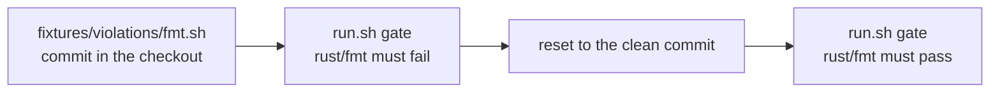

# Gate fixture

`fixtures/rust` is the gate fixture: a one-crate Rust workspace, `app`, with
one function and one test, no dependencies, that passes every gate.

The `fixture` workflow, `.github/workflows/fixture.yml`, proves each of the
seven gates fails closed: `rust/fmt`, `rust/clippy`, `rust/test`,
`rust/mutants`, `rust/kani`, `rust/miri` and `rust/msrv`. For each it
applies one deliberate violation, commits it in the job's checkout only, runs
that one gate in the contained gate container and requires it to fail. It
then restores the checkout and requires the same gate to pass.

Each script in `fixtures/violations` takes no arguments and runs from the
repository root.

| Script       | Violation                                                             | Fails          |
| ------------ | --------------------------------------------------------------------- | -------------- |
| `fmt.sh`     | Appends an unformatted function to `reporter/src/lib.rs`              | `rust/fmt`     |
| `clippy.sh`  | Appends a formatted function with a needless `return`                 | `rust/clippy`  |
| `test.sh`    | Creates `reporter/tests/violation.rs`, one test that panics           | `rust/test`    |
| `mutants.sh` | Adds `reporter/src/violation.rs`, a pure function no test covers      | `rust/mutants` |
| `kani.sh`    | Adds `reporter/src/kani_violation.rs`, a proof asserting `1 + 1 == 3` | `rust/kani`    |
| `miri.sh`    | Adds `reporter/src/miri_violation.rs`, a Miri-only test that leaks    | `rust/miri`    |
| `msrv.sh`    | Lowers `rust-version` to 1.99 and calls `bool::toggle`, a 1.100 API   | `rust/msrv`    |

The mutants gate tests only the lines in `git diff BASE...HEAD`, so the
workflow commits each violation in its own checkout; nothing is pushed, and
the job holds no credential.

The Kani and Miri violations sit behind `cfg(kani)` and `cfg(miri)`, so no
other gate compiles them. The workspace forbids unsafe code, so the Miri
violation is a safe leak, which Miri reports. The msrv gate checks with the
`rust-version` that `Cargo.toml` declares, so lowering it below the APIs the
code uses fails it, while the gates that build with 1.100 still compile the
code.

The workflow's `msrv-validation` job proves `.moon/scripts/msrv.sh`, the
script behind `rust/msrv`, refuses a `rust-version` it cannot trust before
it installs anything. It runs the script with `MSRV_CHECK_ONLY=1` on three
small workspaces and requires each to fail with its reason: a
`rust-version` of `1.1000` (`invalid rust-version`), a member that
declares none (`has no rust-version`), and two members that declare 1.100
and 1.99 (`declares`). Atelier's own workspace must pass and print
`msrv: 1.100`.
