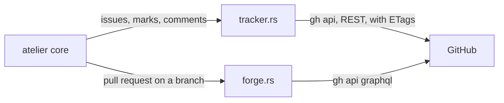

# The `github` plugin

GitHub fills two roles: tracker, for issues, and forge, for pull requests and
their checks. As the forge it offers pipelines three kinds of step:
`github.checks`, `github.ready` and `github.merge`, or `forge.*` in a project
whose forge is GitHub. Every call goes through `gh`, so it carries the user's own
sign-in, and runs with a 30-second deadline.



| File         | Holds                                                                    |
| ------------ | ------------------------------------------------------------------------ |
| `lib.rs`     | `GitHub`, and `Plugin`: registers the tracker, the forge and its steps   |
| `steps.rs`   | The forge's kinds of step: `checks`, `ready` and `merge`                 |
| `api.rs`     | `gh api --include`: status, headers and body; rate limits; encoding      |
| `tracker.rs` | `GitHubTracker`: listing with ETags and pages, search, marking, comments |
| `labels.rs`  | `Labels`: each pipeline's trigger and each mark's label, from settings   |
| `forge.rs`   | One GraphQL query: the pull request and each commit's checks             |
| `ci.rs`      | `.github/workflows/atelier.yml`, calling atelier's reusable `gates.yml`  |
| `clone.rs`   | The URL to clone a repository from, over the protocol `gh` uses          |

```rust
let github = GitHub::new();
let tracker = github.tracker(&settings, &["build", "audit"])?;
let repo = Repo("StevenJPx2/chauffeur".into());
let mine = Filter { assignee: Some("StevenJPx2".into()), ..Filter::default() };

let listing = tracker.issues(&repo, Tag::Trigger("build"), &mine, Some("W/\"f235c4…\""))?;
// GET repos/StevenJPx2/chauffeur/issues?state=open&per_page=100
//     &labels=atelier%3Abuild&assignee=StevenJPx2, If-None-Match: W/"f235c4…"
// → Listing::Unchanged

let pull = github.pull_request(&repo, "issue-12-fix-the-dead-link")?;
// → Some(PullRequest::Open { number: 31, draft: true, failed_rounds: 1, checks: Passed })
```

- **Marks** are labels: a trigger for each of the project's pipelines, in
  its order, `atelier:<pipeline>` such as `atelier:build` or
  `atelier:audit`, then `atelier:working` and `atelier:blocked`. The
  project's `[[tracker]]` sets its own, such as
  `labels.audit = { name = "queue:audit" }` or
  `labels.working = { name = "bot:working" }`; `create_labels` makes them in
  that order, and `improvement`.
- **Labels stay distinct**: no two labels share a name, ignoring case, and a
  trigger's name is at most GitHub's 50 characters. A project that asks for
  either is refused before any call, naming the key, such as
  `labels.working.name: atelier:audit is also labels.audit's name`.
- **Listing** sends the tag atelier holds, so an unchanged repository answers 304.
  It reads at most ten pages of 100, and a listing of more than one page keeps
  no tag. Pull requests are left out.
- **A filter's query** goes through GitHub search, which carries no ETag, so
  each pipeline's trigger listing is one search call per poll; `working`
  stays a REST call with an ETag. Search allows 30 requests a minute, so the
  15-second minimum poll fits about seven pipelines.
- **Failures**: a 403 with `Retry-After` or no rate left, or a 429, waits;
  a 5xx or no reply at all is transient; any other error status is
  permanent. Removing a label that is not there succeeds.
- **Failed rounds** count the pull request's last 100 commits whose combined
  checks failed; the head's checks are pending until they report.
