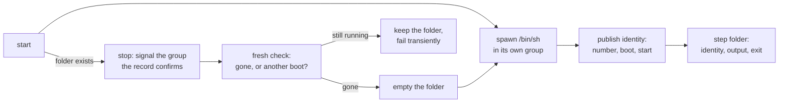

# The background command's stop-and-clear race, in TLA+

**Status: an experiment** (issue #71), which informs #3, the `tla` plugin.
Neither checker is a dependency of atelier, neither is a required gate, and
neither runs on a developer's machine.

The spec reads one race out of `crates/cli/src/command_step/run.rs` on
`feat/run-requests` (PR #57), with the identity check in `identity.rs` and
the signal guard in `crates/command/src/lib.rs`: a start that finds the step
folder an earlier start left. The code looks at a command's identity twice,
and the second look is what keeps the start from orphaning a command that is
still running.

Two model checkers check the same spec, TLC as the reference and
[everystate](https://github.com/mattzcarey/everystate) as the one a plugin
would drive, and CI compares what they say. Two broken variants show what
the guards buy.

| File | Holds |
| --- | --- |
| `CommandStopClear.tla` | The protocol, its actions, its invariants and its one liveness claim |
| `CommandStopClear.cfg` | The bounds, the specification and the invariants checked |
| `CommandStopClearLive.cfg` | The same bounds with fairness, and the property |
| `CommandStopClearBroken.tla` | The protocol with `ClearingUnchecked` in place of `Clearing` |
| `CommandStopClearBroken.cfg` | The same bounds, for the first broken variant |
| `CommandStopClearLoose.tla` | The protocol with `ClearingUnrecorded` added |
| `CommandStopClearLoose.cfg` | The same bounds, for the second broken variant |
| `Dockerfile` | TLC and everystate, pinned by version and checksum, installed only in CI |
| `check.sh` | Runs both checkers over the four configurations, and compares them |

## The race

A background command runs under a `/bin/sh` that leads its own process
group and stays alive until the command's top level ends, then writes
`exit`. The step's folder holds what a later poll reads: `started`,
`worktree`, `identity`, `output` and `exit`. `identity` names the leader's
number, which is also its group's number, the boot it started on, and its
start identity; the daemon publishes it before `start` returns.

A start that finds a folder stops the command the folder still names, looks
at the record a second time, and empties the folder only once that fresh
look finds the leader gone or the record from another boot.

The second look is the experiment. A start that a daemon crash replays
without it empties the only record of a group that is still running, and
then nothing can name that group: not `stop`, not the run's cleanup, and not
a later start. `CommandStopClearBroken.tla` drops exactly that, using
`ClearingUnchecked`, which empties the folder the moment the stop returns.

The other half is the folder atelier inherits. A `group` file from an earlier
atelier, or a record it cannot read, names the number of a command that may
still be running. The design keeps that folder and sends no signal. A start
that treats such a folder as empty and clears it loses the only trace of that
command, which is `ClearingUnrecorded` in `CommandStopClearLoose.tla`.

| Action | The call in the code |
| --- | --- |
| `Spawning(p)` | `start`'s folder, `started`, `worktree` and spawn |
| `Publishing` | `Identity::of` and `publish` |
| `Abandoning` | `abandon`, when the identity cannot be recorded |
| `SpawnFailing` | A start that cannot spawn, and the folder it removes |
| `Ending(p)` | The shell writing `exit` once the top level ends |
| `LeaderExiting(p)` | The leader exiting; `check` reads a zombie as gone |
| `LeaderVanishing(p)` | A leader ended by something else, which writes no `exit` |
| `Reaping(p)` | `reap`'s reaper thread |
| `Foreign(p)` | A number taken by a process atelier did not start |
| `Rebooting` | A restart of the computer, which `judge` reads as `Rebooted` |
| `Stopping` | `stop`, and the stop a start's `clear` makes first |
| `TimingOut` | `observe`'s kill past the time limit |
| `Clearing` | `clear`'s fresh check and `remove_dir_all` |
| `ClearingUnchecked` | `clear` without the fresh check: the first variant |
| `ClearingUnrecorded` | A clear over a record it cannot act on: the second |

## What the model keeps apart

The daemon's are the folder, the child a start holds unreaped, and the
history of which processes atelier started and signalled. The system's are
the boot and the table of process numbers. The numbers, the boots and the
most incarnations a number gets are `Pids`, `Boots` and `Stamp`, which each
`.cfg` sets, so a larger model needs no edit to the module.

A process is an identity, `<<number, boot, start>>`, and a number that a
later process took is a different process to both invariants. `Foreign`
takes a free number for a process atelier did not start, which is the reuse
the identity check exists for: the record still names the old start, so the
check reads `Gone` and nothing is signalled.

`Named` ties every kind of folder to the one number it stands for: a
published record must match the process's boot and start, a folder whose
identity is not published names only the child its start still holds, and a
`group` file or a record that cannot be read names the number in it. Those
two inherited records arrive with the command an earlier atelier started on
that number, so the folder the design refuses to touch is one a process is
still running under, not an empty corner of the state space.

A signal may be refused by the guard or fail in `/bin/kill`, and `Stopping`,
`TimingOut` and `Abandoning` each model that branch: the group stays running
and the folder is kept, since it is then the only trace of a command that
may still run. A command that writes its exit needs no signal, and neither
does a record from another boot, a leader that has gone or become a zombie,
or a number another process took.

What is not here: the commands inside a group, so a signalled group leaves
nothing behind; descendants that create their own group; the child a start
holds between the spawn and the publication, which is the one thing a crash
would lose while it runs, and which atelier answers by keeping a folder it
cannot read; and the window between the check and `/bin/kill`, because
reading the record and signalling the group it names are one action, as they
are one call. The kill window is the follow-up, and with `Foreign` in place
it is expressible as a third variant that checks and then signals: it would
fail `NoUnconfirmedSignal`, which is the residual the code names itself.

A folder whose record cannot name a leader is never emptied, and the start
over it fails transiently for good. `Init` chooses an empty folder or one of
the two atelier inherits, over a command still running, so those paths are
reachable; the model keeps that as a state with nothing left to do, which is
why every configuration sets `CHECK_DEADLOCK FALSE`.

## The invariants

| Check | Says |
| --- | --- |
| `TypeOK` | Every variable stays in its domain |
| `NoOrphanedLeader` | A process atelier started, and that still leads its group, is still named by the folder: its published record, the start that holds it, or the record an earlier atelier left |
| `NoUnconfirmedSignal` | Every signal names a process atelier started a group for |
| `ReapedEventually` | A leader that exited is eventually reaped, so its number is reusable, under weak fairness on each number's reaper |

The first two are state predicates over the reachable states, and each
broken variant fails `NoOrphanedLeader` by removing one guard, with no flag
and no other change: emptying a folder while its command runs, or emptying a
folder whose record atelier cannot act on behind a command that still runs.
The third is the one liveness claim the code itself makes, in its own
configuration, with a fairness assumption for each number's reaper.

## Running it

Never on a developer's machine. A pull request that changes this folder runs
`.github/workflows/tla.yml`, which

1. builds this folder's `Dockerfile`, installing TLC (`tla2tools.jar`
   v1.7.4) from its release and everystate (0.3.1) from the `.crate` that
   crates.io published, each verified against a pinned checksum first;
2. runs `check.sh` in a container with no network, a read-only root, a
   read-only mount of this folder, a non-root user, no capabilities, and a
   limit on processes and memory;
3. prints what each checker said in the job summary and keeps the whole
   output as an artifact.

On the Mac: none of it. Neither checker is installed there and neither is
run there, and no gate and no required check depends on this folder.

`check.sh` fails the job when the good spec is not a pass on both checkers,
when either broken variant is not the safety violation that TLC reports as
exit status 12 on both, when TLC does not clear the property, or when a
checker counts no states. A checker that finds a liveness violation where
the other does not also fails. A tool that will not check a property at all
is reported as a finding rather than a failure, because what each tool does
with `PROPERTY` is one of the things this experiment exists to find out.

## Result

A run of `.github/workflows/tla.yml` (run 44233059137) counted:

| What | Checker | Verdict | Generated | Distinct | Wall clock |
| --- | --- | --- | --- | --- | --- |
| Invariants | TLC | passed, exit 0 | 517,722 | 188,376 | 3.8 s |
| Invariants | everystate | passed, exit 0 | 517,722 | 188,376 | 1.5 s |
| No fresh check | TLC | violated, exit 12 | 173 | 111 | 919 ms |
| No fresh check | everystate | violated, exit 12 | 173 | 111 | 5 ms |
| Record it cannot act on | TLC | violated, exit 12 | 25 | 23 | 885 ms |
| Record it cannot act on | everystate | violated, exit 12 | 25 | 23 | 5 ms |
| Liveness | TLC | passed, exit 0 | 517,722 | 188,376 | 16.2 s |
| Liveness | everystate | passed, exit 0 | 517,722 | 188,376 | 1.7 s |

The two agree everywhere: the same verdict, the same states generated and
distinct, and the same search depth, 35 for the safe graph, 4 for the first
broken variant and 2 for the second. everystate checks `PROPERTY`, fairness
included, and its answer is TLC's.

The counts repeat exactly from run to run; the times move by a few hundred
milliseconds with the runner.

The first counterexample is four states: the initial state, with no folder;
`Spawning(2)`, where number 2 leads a group and the folder holds `started`
and `worktree`; `Publishing`, where the record names number 2, boot 0, start
1; and `ClearingUnchecked`, where the folder is gone while number 2 is still
a leader.

The second is two states: a folder an earlier atelier left, `legacy`, with
number 2 still a leader and `<<2, 0, 1>>` in `ours`; and
`ClearingUnrecorded`, where that folder is gone and number 2 still leads its
group. That is the whole of the guard the design keeps around a record it
cannot act on, and one action is enough to lose it.

Neither checker finds a violation in the protocol as written, across 188,376
states: the design holds, and each guard is load-bearing.

Time is where they part: at this size TLC takes 2.5 times as long on the
graph and 9.5 times as long with the property, and it pays about 700 ms of
JVM start on every run while everystate starts in about a millisecond.

## everystate, as it stands

- Published as 0.3.1 on 2026-11-17, five days after its repository was
  created; MIT, 58 stars, 4 forks, 51 downloads of the crate, one
  contributor, 68 commits, two open issues.
- One of those issues is an evaluation-order bug: a set filter over a
  Cartesian product cannot see a variable assigned earlier in `Init`. The
  models here avoid it, and a spec under #3 might not.
- Its README claims 122 of 122 `tlaplus/Examples` models (up to 5 s) match
  TLC on result and exact state counts, 384 of 414 of TLC's own test-model
  suite match, and 12 benchmarks run 1.1x to 4.6x faster than single-worker
  TLC.
- It keeps every state in memory, a few million distinct states being its
  practical limit, runs one worker, and does not check TLAPS proofs, Java
  module overrides or subexpression selectors.
- It prints TLC's banner, summary lines and exit statuses, checks `PROPERTY`
  with fairness, and ships `everystate java`, which accepts a
  `java -cp tla2tools.jar tlc2.TLC` command line, so a tool written for TLC
  can drive it unchanged.

## For #3

Both checkers speak TLC's contract: exit statuses 0, 10, 11, 12, 13 and 150
or 151 for a parse or config error, the same summary lines, the same state
counts on this spec, and `everystate java` as a drop-in command line. The
plugin does not have to choose between them to start, and it should order
them instead:

1. **TLC is the checker #3 requires.** It is the reference the other is
   measured against, it is one jar with a checksum, the gate container
   already carries a JVM, and no conformance question attaches to it.
2. **everystate is an optional second checker**, behind a setting, so a spec
   can be checked twice in one job and the two compared, as this folder
   does. It is five days old, pre-1.0 and one maintainer: worth running
   beside TLC, and too young to be the only checker a plugin trusts.
3. **The follow-up worth having is trace conformance**, not more speed:
   everystate reads a trace and says whether a spec allows it, which would
   let a run's own record of what happened be checked against the spec, not
   only the spec against itself. #71 puts that out of scope, and it is the
   reason the tool matters more than its start-up time.
